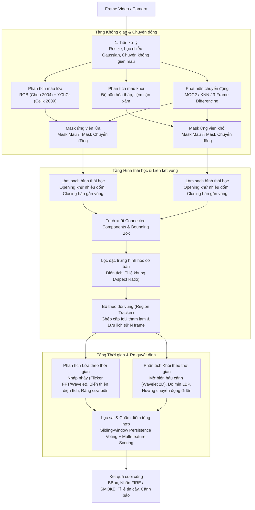

# Hệ Thống Phát Hiện Khói Và Lửa Từ Video (Computer Vision)

> **Bài tập lớn môn Xử lý ảnh — Học viện Công nghệ Bưu chính Viễn thông (PTIT)**  
> **Chủ đề:** Phát hiện khói và lửa trong chuỗi video giám sát thời gian thực.  
> **Định hướng kỹ thuật:** Tập trung chuyên sâu vào **Xử lý ảnh truyền thống (Classical Computer Vision)** nhằm khai thác tối đa năng lực phân tích tín hiệu ảnh, thiết kế theo kiến trúc module hóa chuẩn mực, sẵn sàng tích hợp mở rộng sang **Học sâu (Deep Learning)**.

---

## 📑 Mục lục

1. [Tổng quan & Kiến trúc Pipeline](#1-tổng-quan--kiến-trúc-pipeline)
2. [Cơ sở lý thuyết & Kỹ thuật cốt lõi](#2-cơ-sở-lý-thuyết--kỹ-thuật-cốt-lõi)
3. [Cấu trúc thư mục dự án](#3-cấu-trúc-thư-mục-dự-án)
4. [Môi trường & Hướng dẫn cài đặt](#4-môi-trường--hướng-dẫn-cài-đặt)
5. [Quy trình phát triển & Lộ trình thực hiện](#5-quy-trình-phát-triển--lộ-trình-thực-hiện)
6. [Hệ thống đánh giá & Chỉ số](#6-hệ-thống-đánh-giá--chỉ-số)
7. [Phân công công việc nhóm](#7-phân-công-công-việc-nhóm-4-thành-viên)
8. [Tài liệu tham khảo](#8-tài-liệu-tham-khảo)

---

## 1. Tổng quan & Kiến trúc Pipeline

Hệ thống được thiết kế dạng pipeline đa tầng lọc nối tiếp. Nguyên lý cốt lõi là **mỗi tầng sẽ loại trừ một nhóm đối tượng gây nhiễu (false positives)** đặc thù:



---

## 2. Cơ sở lý thuyết & Kỹ thuật cốt lõi

### 2.1. Phân tích màu sắc (Color Modeling)
- **Lửa — Không gian RGB & Bão hòa (Chen et al., 2004):**
  - Điều kiện độ sáng kênh đỏ: $R > R_T$ (với ngưỡng $R_T \approx 115 - 135$).
  - Quan hệ giữa các kênh màu: $R \ge G > B$.
  - Độ bão hòa $S$ phụ thuộc độ sáng: $S \ge (255 - R) \cdot \frac{S_T}{R_T}$.
- **Lửa — Không gian YCbCr (Çelik & Demirel, 2009):**
  - Tách bạch thông tin độ chói $Y$ và hai thành phần sắc độ $Cr$ (đỏ), $Cb$ (xanh dương):
    $$\begin{cases} Y > Cb \\ Cr > Cb \\ Y > Y_{mean}, \quad Cr > Cr_{mean}, \quad Cb < Cb_{mean} \\ |Cb - Cr| \ge \tau \end{cases}$$
- **Khói:**
  - Khói thường có màu trắng xám hoặc xám đậm, đặc trưng bởi độ bão hòa rất thấp và sự cân bằng giữa 3 kênh màu:
    $$\max(|R - G|, |G - B|, |R - B|) \le \alpha, \quad S \le S_{smoke}, \quad V_{min} \le V \le V_{max}$$

### 2.2. Tách nền & Phân tích chuyển động (Motion Analysis)
- **Gaussian Mixture Models (MOG2 / KNN):** Cập nhật mô hình nền thích nghi theo thời gian, phân tách foreground khỏi môi trường nền tĩnh (loại bỏ biển báo đỏ, tường đỏ, hoa văn tĩnh).
- **Three-frame Differencing:** Phương án dự phòng tính toán nhanh bằng hiệu trị tuyệt đối giữa 3 khung hình liên tiếp.
- **Optical Flow (Farnebäck):** Phân tích trường vector vận tốc chuyển động cục bộ. Khói tự nhiên luôn có xu hướng khuếch tán và chuyển động hướng lên trên ($dy < 0$).

### 2.3. Phân tích biến đổi theo thời gian (Temporal Analysis — Điểm nhấn XLA)
- **Đặc trưng nhấp nháy ngọn lửa (Flicker Analysis - Töreyin et al., 2006):**
  - Ngọn lửa thực tế luôn dao động hỗn loạn không chu kỳ ở dải tần số $3 - 13\text{ Hz}$.
  - Thuật toán phân tích phổ năng lượng qua **Biến đổi Fourier nhanh (FFT)** và **Biến đổi Wavelet 1D (Haar DWT)** trên chuỗi thời gian cường độ sáng / pixel để loại trừ vật thể màu đỏ chuyển động cứng (áo đỏ, đèn xe).
- **Biến dạng hình học:**
  - Hệ số biến thiên diện tích $\sigma(Area) / \mu(Area)$ qua cửa sổ trượt $N$ frames.
  - Đo độ gồ ghề của biên (Boundary Roughness: Chu vi contour / Chu vi bao lồi Convex Hull).
  - Độ tương đồng hình dạng giữa các frame liên tiếp qua khoảng cách Hu Moments.
- **Đặc trưng tán xạ của khói (Töreyin et al., 2005):**
  - Khói bán trong suốt làm mờ các chi tiết tần số cao của cảnh nền phía sau $\rightarrow$ năng lượng wavelet 2D tần số cao giảm mạnh so với ảnh nền tham chiếu.
  - Phân tích cấu trúc bề mặt (Texture Smoothness) qua biểu đồ **Local Binary Patterns (LBP)**.

### 2.4. Theo dõi & Lọc phát hiện sai (Tracking & Decision Making)
- **Theo dõi vùng (Region Tracking):** Ghép cặp bounding box qua độ đo Intersection-over-Union (IoU) theo cơ chế greedy, cấp phát `track_id` và duy trì lịch sử chuyển động.
- **Bỏ phiếu trượt (Persistence Voting):** Yêu cầu đối tượng phải xuất hiện ít nhất $K$ lần trong $N$ khung hình gần nhất để loại bỏ đốm nhiễu ngẫu nhiên.
- **Chấm điểm đa đặc trưng (Multi-feature Scoring):** Kết hợp các trọng số thành phần qua hàm dốc tuyến tính (linear ramp) chuẩn hóa về $[0, 1]$.

---

## 3. Cấu trúc thư mục dự án

```text
fire_detect/
├── configs/
│   └── default.yaml             # File cấu hình tham số tập trung (ngưỡng màu, MOG2, scoring, tracking)
├── data/
│   ├── raw/                     # Video gốc độ phân giải cao thu thập từ các bộ dữ liệu
│   ├── samples/                 # Video clip ngắn phục vụ kiểm thử và demo
│   └── annotations/             # File nhãn Ground Truth dạng JSON theo khung hình
├── docs/
│   └── report/                  # Báo cáo kỹ thuật, slide thuyết trình, biểu đồ minh họa
├── notebooks/                   # Jupyter Notebooks phục vụ EDA và trực quan hóa phân bố màu
├── outputs/                     # Video kết quả xuất ra, biểu đồ đánh giá, file CSV ablation
├── src/                         # Thư mục mã nguồn chính (được module hóa)
│   ├── color/                   # Phân tích không gian màu lửa và khói
│   ├── detectors/               # Bộ phát hiện: BaseDetector (interface), Classical, Deep
│   ├── evaluation/              # Công cụ tính chỉ số đánh giá (Precision, Recall, F1, FAR, Latency)
│   ├── filtering/               # Hình thái học, trích xuất candidates, luật hình học & chấm điểm
│   ├── motion/                  # Trừ nền MOG2/KNN và phân tích Optical Flow
│   ├── preprocessing/           # Resize chuẩn hóa, lọc Gaussian blur, chuyển đổi không gian màu
│   ├── temporal/                # Phân tích chuỗi thời gian: Flicker FFT/Wavelet, LBP, biến dạng
│   ├── tracking/                # Bộ theo dõi liên kết vùng qua thời gian (RegionTracker)
│   ├── video_io/                # Trình bao đọc/ghi video tuần tự (VideoReader, VideoWriter)
│   └── visualization/           # Vẽ bounding box, nhãn và ghép lưới ảnh debug đa tầng
├── scripts/                     # Các kịch bản thực thi độc lập (CLI runner, ablation, phân tích màu)
├── tests/                       # Bộ kiểm thử tự động với pytest
├── app/                         # Giao diện demo tương tác trực quan (Streamlit)
├── ke_hoach_trien_khai.md       # Bản kế hoạch chi tiết, tiêu chuẩn kỹ thuật và roadmap bài tập lớn
├── requirements.txt             # Danh mục thư viện phụ thuộc
├── pytest.ini                   # Cấu hình kiểm thử pytest
└── .gitignore                   # Cấu hình bỏ qua tệp tạm, dữ liệu nặng và môi trường ảo
```

---

## 4. Môi trường & Hướng dẫn cài đặt

### 4.1. Yêu cầu hệ thống
- **Hệ điều hành:** Windows 10/11 (hỗ trợ Linux / macOS tương đương).
- **Python:** Phiên bản 3.10 trở lên (khuyến nghị Python 3.12).

### 4.2. Kích hoạt môi trường ảo
Thư mục môi trường ảo `.venv` đã được khởi tạo và cài đặt sẵn các thư viện cần thiết:

```powershell
# Trên Windows PowerShell:
.\.venv\Scripts\Activate.ps1

# Hoặc thực thi trực tiếp bằng trình thông dịch của môi trường ảo:
.\.venv\Scripts\python.exe <tên_script>.py
```

### 4.3. Cài đặt lại thư viện (nếu cần thiết lập máy mới)
```powershell
python -m venv .venv
.\.venv\Scripts\Activate.ps1
python -m pip install --upgrade pip
pip install -r requirements.txt
```

Các thư viện chính được sử dụng:
- **`opencv-python`**: Đọc/ghi video, biến đổi không gian màu, MOG2, contour, morphology, optical flow.
- **`numpy` & `scipy`**: Xử lý ma trận ảnh số, biến đổi Fourier (FFT), lọc tín hiệu chuỗi thời gian.
- **`PyWavelets`**: Biến đổi Wavelet 1D (đo flicker) và Wavelet 2D (đo năng lượng làm mờ biên nền).
- **`scikit-image`**: Trích xuất đặc trưng hình thái (`regionprops`) và kết cấu bề mặt LBP.
- **`PyYAML`**: Quản lý và nạp file cấu hình tham số.
- **`matplotlib` & `pandas`**: Xuất biểu đồ phân bố màu và bảng chỉ số thực nghiệm.
- **`streamlit`**: Xây dựng giao diện web demo trực quan có thanh trượt điều chỉnh ngưỡng trực tiếp.
- **`pytest`**: Kiểm thử tự động từng hàm/module.

---

## 5. Quy trình phát triển & Lộ trình thực hiện

Chi tiết từng bước thuật toán, biểu thức toán học và danh sách tham số tham khảo chi tiết tại [`ke_hoach_trien_khai.md`](file:///d:/PTIT/XLA/fire_detect/ke_hoach_trien_khai.md).

### Giai đoạn 1: Xây dựng nền tảng I/O, Tiền xử lý & Phân tích màu
1. Cài đặt đọc/ghi video với [`src/video_io`](file:///d:/PTIT/XLA/fire_detect/src/video_io).
2. Xây dựng hàm tiền xử lý resize giữ tỉ lệ và làm mịn tại [`src/preprocessing`](file:///d:/PTIT/XLA/fire_detect/src/preprocessing).
3. Triển khai các hàm phân tích luật màu lửa (RGB + YCbCr) và màu khói tại [`src/color`](file:///d:/PTIT/XLA/fire_detect/src/color).
4. Viết unit test trong [`tests/test_color.py`](file:///d:/PTIT/XLA/fire_detect/tests/test_color.py) để nghiệm thu.

### Giai đoạn 2: Phân tích chuyển động & Liên kết vùng
1. Cài đặt bộ trừ nền MOG2/KNN và hiệu 3 frame trong [`src/motion`](file:///d:/PTIT/XLA/fire_detect/src/motion).
2. Kết hợp mặt nạ màu và mặt nạ chuyển động, làm sạch bằng phép toán hình thái học Opening/Closing tại [`src/filtering`](file:///d:/PTIT/XLA/fire_detect/src/filtering).
3. Trích xuất connected components thành danh sách `Region` và xây dựng bộ theo dõi [`src/tracking`](file:///d:/PTIT/XLA/fire_detect/src/tracking).

### Giai đoạn 3: Phân tích chuỗi thời gian & Bộ lọc phát hiện sai
1. Xây dựng bộ đếm pixel flicker map và hàm phân tích năng lượng nhấp nháy (FFT, Wavelet) trong [`src/temporal`](file:///d:/PTIT/XLA/fire_detect/src/temporal).
2. Tính toán các đặc trưng hình học biến thiên (diện tích, độ răng cưa biên, LBP, mờ biên nền).
3. Triển khai thuật toán bỏ phiếu trượt (persistence) và hàm chấm điểm tổng hợp tại [`src/filtering`](file:///d:/PTIT/XLA/fire_detect/src/filtering).

### Giai đoạn 4: Tích hợp Pipeline, Đánh giá thực nghiệm & Demo
1. Hoàn thiện lớp `ClassicalDetector` tại [`src/detectors/classical.py`](file:///d:/PTIT/XLA/fire_detect/src/detectors/classical.py).
2. Xây dựng script chạy đánh giá dataset và ablation study trong [`src/evaluation`](file:///d:/PTIT/XLA/fire_detect/src/evaluation) và [`scripts/`](file:///d:/PTIT/XLA/fire_detect/scripts).
3. Hoàn thiện giao diện demo [`app/streamlit_app.py`](file:///d:/PTIT/XLA/fire_detect/app/streamlit_app.py).

---

## 6. Hệ thống đánh giá & Chỉ số

Hệ thống được đánh giá theo 2 cấp độ:

### 6.1. Đánh giá mức Khung hình (Frame-level)
- **Precision:** $\frac{TP}{TP + FP}$ — Tỉ lệ khung hình báo cháy là chính xác.
- **Recall:** $\frac{TP}{TP + FN}$ — Tỉ lệ khung hình có cháy thực tế được hệ thống phát hiện.
- **F1-Score:** Trung bình điều hòa giữa Precision và Recall.
- **False Alarm Rate (FAR):** $\frac{FP}{FP + TN}$ — Tỉ lệ khung hình an toàn (không có cháy) bị báo nhầm (chỉ số quan trọng đối với hệ thống camera giám sát).

### 6.2. Đánh giá mức Sự kiện (Event-level)
- **Detection Latency (Độ trễ phát hiện):** Thời gian (giây) kể từ lúc ngọn lửa/khói bắt đầu xuất hiện trên video cho đến khi hệ thống phát ra cảnh báo đầu tiên.
- **Tốc độ xử lý (FPS):** Tốc độ khung hình xử lý trên giây để đảm bảo khả năng chạy realtime trên camera.

---

## 7. Phân công công việc nhóm (4 thành viên)

| Thành viên | Trách nhiệm chính | Module & Nhiệm vụ cụ thể |
|---|---|---|
| **Thành viên 1** *(Trưởng nhóm)* | Kiến trúc luồng, Tiền xử lý, Tích hợp Pipeline & Giao diện Demo | - Xây dựng `src/video_io/` và `src/preprocessing/`<br/>- Quản lý cấu hình `src/config.py` và `configs/default.yaml`<br/>- Tích hợp pipeline hoàn chỉnh `src/detectors/classical.py`<br/>- Xây dựng ứng dụng demo `app/streamlit_app.py` |
| **Thành viên 2** | Mô hình hóa màu sắc, Thu thập & Chuẩn hóa dữ liệu | - Cài đặt luật màu lửa & khói trong `src/color/`<br/>- Viết script phân tích phân bố màu `scripts/analyze_color.py`<br/>- Thu thập và gán nhãn dataset chuẩn (Bilkent, MIVIA, FIRESENSE)<br/>- Viết unit test cho tầng phân tích màu (`tests/test_color.py`) |
| **Thành viên 3** | Phát hiện chuyển động, Liên kết vùng (Tracking) & Đo nhấp nháy | - Cài đặt bộ trừ nền MOG2/KNN và hiệu 3 frame trong `src/motion/`<br/>- Cài đặt Optical Flow phân tích hướng di chuyển<br/>- Cài đặt bộ theo dõi `src/tracking/region_tracker.py`<br/>- Cài đặt phân tích nhấp nháy `src/temporal/flicker.py` (FFT & Wavelet) |
| **Thành viên 4** | Phân tích đặc trưng khói, Lọc phát hiện sai & Đánh giá thực nghiệm | - Cài đặt đặc trưng khói (độ mờ biên nền, texture LBP) trong `src/temporal/`<br/>- Cài đặt hình thái học, lọc hình học và chấm điểm trong `src/filtering/`<br/>- Xây dựng module đánh giá chỉ số `src/evaluation/`<br/>- Thực hiện thực nghiệm bóc tách (Ablation study) và viết báo cáo |

---

## 8. Tài liệu tham khảo

1. **Chen, T.-H., Wu, P.-H., & Chiou, Y.-C. (2004).** *An early fire-detection method based on image processing.* In IEEE International Conference on Image Processing (ICIP), pp. 1707–1710.
2. **Çelik, T., & Demirel, H. (2009).** *Fire detection in video sequences using a generic color model.* Fire Safety Journal, 44(2), pp. 147–158.
3. **Töreyin, B. U., Dedeoğlu, Y., Güdükbay, U., & Çetin, A. E. (2006).** *Computer vision based method for real-time fire and flame detection.* Pattern Recognition Letters, 27(1), pp. 49–58.
4. **Töreyin, B. U., Dedeoğlu, Y., & Çetin, A. E. (2005).** *Wavelet based real-time smoke detection in video.* In European Signal Processing Conference (EUSIPCO), pp. 1–4.
5. **Farnebäck, G. (2003).** *Two-frame motion estimation based on polynomial expansion.* In Scandinavian Conference on Image Analysis (SCIA), pp. 363–370.
