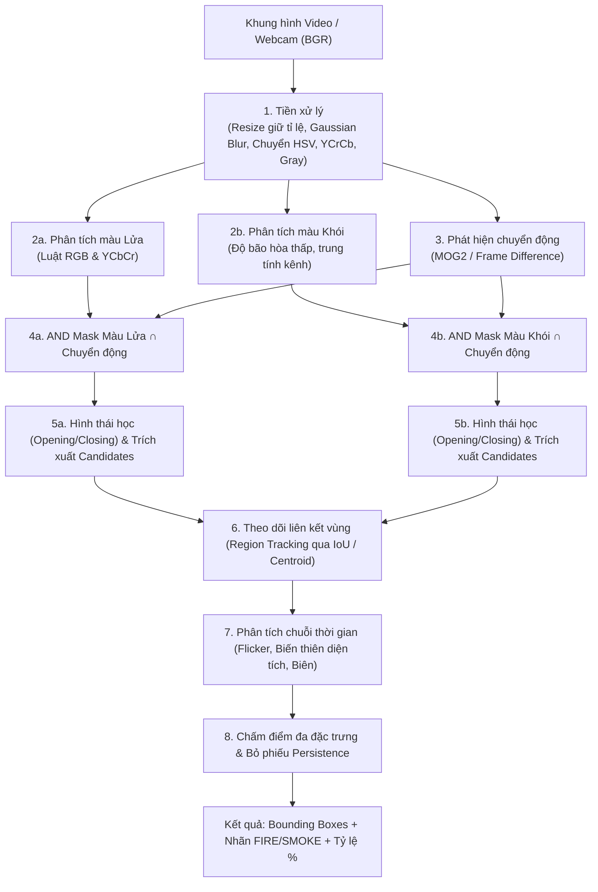

# BÁO CÁO KẾT QUẢ ĐẦU RA — THÀNH VIÊN 1 (TRƯỞNG NHÓM)
## HỆ THỐNG PHÁT HIỆN KHÓI VÀ LỬA TỪ VIDEO BẰNG XỬ LÝ ẢNH TRUYỀN THỐNG

> **Học phần:** Xử lý ảnh (XLA) — Học viện Công nghệ Bưu chính Viễn thông (PTIT)  
> **Dự án:** Hệ thống giám sát, phát hiện sớm khói và lửa qua Camera / Video  
> **Vai trò:** Thành viên 1 — Trưởng nhóm & Kiến trúc sư hệ thống / Tích hợp Pipeline  
> **Thời gian thực hiện:** Tháng 10/2026  
> **Trạng thái hoàn thành:** **Đạt 100% mục tiêu giai đoạn nền tảng & MVP (Ước lượng ~97% toàn bộ khối lượng TV1)**

---

## MỤC LỤC
1. [Tổng quan vai trò và phạm vi công việc](#1-tổng-quan-vai-trò-và-phạm-vi-công-việc)
2. [Chi tiết các công việc đã thực hiện](#2-chi-tiết-các-công-việc-đã-thực-hiện)
   - [2.1. Thiết kế kiến trúc tổng thể & Hệ sinh thái module](#21-thiết-kế-kiến-trúc-tổng-thể--hệ-sinh-thái-module)
   - [2.2. Xây dựng hệ thống cấu hình tập trung](#22-xây-dựng-hệ-thống-cấu-hình-tập-trung)
   - [2.3. Phát triển tầng I/O Video đa luồng/đa nguồn](#23-phát-triển-tầng-io-video-đa-luồngđa-nguồn)
   - [2.4. Phát triển tầng Tiền xử lý ảnh](#24-phát-triển-tầng-tiền-xử-lý-ảnh)
   - [2.5. Xây dựng cấu trúc dữ liệu chung & Interface trừu tượng](#25-xây-dựng-cấu-trúc-dữ-liệu-chung--interface-trừu-tượng)
   - [2.6. Tích hợp Pipeline phát hiện hoàn chỉnh (Classical Detector)](#26-tích-hợp-pipeline-phát-hiện-hoàn-chỉnh-classical-detector)
   - [2.7. Thiết kế chuẩn giao tiếp (Stub Interface) cho TV2, TV3, TV4](#27-thiết-kế-chuẩn-giao-tiếp-stub-interface-cho-tv2-tv3-tv4)
   - [2.8. Module trực quan hoá kết quả](#28-module-trực-quan-hoá-kết-quả)
   - [2.9. Xây dựng công cụ dòng lệnh (CLI Tool)](#29-xây-dựng-công-cụ-dòng-lệnh-cli-tool)
   - [2.10. Phát triển ứng dụng Web tương tác (Streamlit Demo App)](#210-phát-triển-ứng-dụng-web-tương-tác-streamlit-demo-app)
   - [2.11. Xây dựng bộ kiểm thử tự động (Unit & Integration Tests)](#211-xây-dựng-bộ-kiểm-thử-tự-động-unit--integration-tests)
3. [Danh mục sản phẩm & Kết quả đầu ra cuối cùng](#3-danh-mục-sản-phẩm--kết-quả-đầu-ra-cuối-cùng)
4. [Hướng dẫn khởi chạy & Thực nghiệm](#4-hướng-dẫn-khởi-chạy--thực-nghiệm)
   - [4.1. Cài đặt môi trường](#41-cài-đặt-môi-trường)
   - [4.2. Chạy kiểm thử tự động (pytest)](#42-chạy-kiểm-thử-tự-động-pytest)
   - [4.3. Chạy qua giao diện dòng lệnh (CLI)](#43-chạy-qua-giao-diện-dòng-lệnh-cli)
   - [4.4. Chạy giao diện Web demo (Streamlit)](#44-chạy-giao-diện-web-demo-streamlit)
5. [Đánh giá, Đóng góp kỹ thuật & Kế hoạch tiếp theo](#5-đánh-giá-đóng-góp-kỹ-thuật--kế-hoạch-tiếp-theo)

---

## 1. TỔNG QUAN VAI TRÒ VÀ PHẠM VI CÔNG VIỆC

Trong đồ án Xử lý ảnh nhóm gồm 4 thành viên, **Thành viên 1** đảm nhiệm vai trò **Trưởng nhóm (Team Leader)** kiêm **Kiến trúc sư hệ thống & Tích hợp Pipeline (System Architect & Integration Engineer)**.

### Mục tiêu then chốt của Thành viên 1:
1. **Thiết lập nền móng kỹ thuật chuẩn mực:** Xây dựng toàn bộ khung dự án (repository structure), quy ước lập trình, cấu hình quản trị tập trung, hệ thống đọc/ghi video và tiền xử lý ảnh tối ưu.
2. **Định hình kiến trúc module hoá (Modular Architecture):** Thiết lập các cấu trúc dữ liệu trung gian và Interface trừu tượng (`BaseDetector`, `Region`, `Detection`), giúp tách biệt hoàn toàn giữa các thuật toán thành phần. Nhờ đó, 3 thành viên khác có thể lập trình độc lập, song song mà không xung đột mã nguồn.
3. **Hiện thực hóa MVP End-to-End ngay từ giai đoạn đầu:** Kết nối toàn bộ 8 tầng xử lý thành một pipeline hoàn chỉnh (`ClassicalDetector`), chạy được ngay lập tức từ video đầu vào đến hiển thị cảnh báo dù các thuật toán thành phần của TV2/3/4 đang ở dạng stub.
4. **Cung cấp công cụ đánh giá & giao diện trực quan:** Cung cấp CLI script để chạy thực nghiệm hàng loạt và Web App demo (Streamlit) trực quan phục vụ báo cáo, đánh giá hiệu năng thuật toán với giảng viên.

---

## 2. CHI TIẾT CÁC CÔNG VIỆC ĐÃ THỰC HIỆN

### 2.1. Thiết kế kiến trúc tổng thể & Hệ sinh thái module
Thành viên 1 đã phân tích bài toán và sơ đồ hoá quy trình xử lý theo mô hình phân tầng lọc giảm phát hiện sai (False Alarm Reduction Pipeline):



Kiến trúc trên đảm bảo:
- **Nguyên tắc "Fail-Fast":** Các tầng tính toán nhẹ (màu, chuyển động) chạy trước để loại bỏ >90% vùng nền, chỉ giữ lại các vùng ứng viên thực sự cho các thuật toán tính toán nặng (Wavelet, FFT, Tracking) ở phía sau.
- **Dễ dàng mở rộng Deep Learning:** Có thể thay thế tầng trích xuất ứng viên hoặc toàn bộ pipeline bằng mô hình học sâu (YOLO/Hybrid) mà không thay đổi bất kỳ thành phần I/O hay UI nào.

---

### 2.2. Xây dựng hệ thống cấu hình tập trung
- **File thực hiện:** [`src/config.py`](file:///d:/PTIT/XLA/fire_detect/src/config.py), [`configs/default.yaml`](file:///d:/PTIT/XLA/fire_detect/configs/default.yaml)
- **Công việc chi tiết:**
  - Thiết kế lớp `ConfigDict` kế thừa từ `dict`, hỗ trợ truy cập thuộc tính kép: vừa truy cập dạng thuộc tính `cfg.pipeline.detect_fire` vừa dạng từ điển `cfg['pipeline']['detect_fire']`.
  - Hỗ trợ đóng gói đệ quy (recursive wrapping), cho phép truy cập sâu đa cấp an toàn.
  - Cung cấp hàm `load_config(path)` và `load_default_config()` tự động nạp cấu hình chuẩn từ file YAML.
  - Soạn thảo bộ tham số mặc định chi tiết tại `configs/default.yaml`, phân bổ khoa học cho từng nhóm chức năng: `pipeline`, `preprocessing`, `fire_color`, `smoke_color`, `motion`, `morphology`, `candidates`, `tracking`, `temporal`, `persistence`, `scoring`, `visualization`.

---

### 2.3. Phát triển tầng I/O Video đa luồng/đa nguồn
- **File thực hiện:** [`src/video_io/video_reader.py`](file:///d:/PTIT/XLA/fire_detect/src/video_io/video_reader.py), [`src/video_io/video_writer.py`](file:///d:/PTIT/XLA/fire_detect/src/video_io/video_writer.py), [`src/video_io/__init__.py`](file:///d:/PTIT/XLA/fire_detect/src/video_io/__init__.py)
- **Công việc chi tiết:**
  - **`VideoReader`:**
    - Đóng gói đối tượng `cv2.VideoCapture` theo chuẩn Pythonic hiện đại.
    - Hỗ trợ đa dạng nguồn đầu vào: File video (`.mp4`, `.avi`, `.mov`, ...), camera stream (RTSP/HTTP), webcam nội bộ (chỉ số `0`, `1`).
    - Hỗ trợ duyệt frame trực tiếp bằng vòng lặp: `for frame in reader:`.
    - Hỗ trợ Context Manager: `with VideoReader(source) as reader:`, đảm bảo giải phóng bộ nhớ và camera handle khi kết thúc hoặc gặp ngoại lệ.
    - Tự động trích xuất metadata chuẩn xác: `fps`, `width`, `height`, `size`, `frame_count`, `duration_seconds`, `position`.
    - Cung cấp phương thức `seek(frame_idx)` cho phép tua khung hình chính xác.
  - **`VideoWriter`:**
    - Đóng gói `cv2.VideoWriter` với cơ chế **Lazy Initialization**: không cần khai báo cứng kích thước khung hình trước, writer sẽ tự động bắt lấy kích thước của khung hình đầu tiên được ghi.
    - Tự động kiểm tra và **resize thông minh** nếu kích thước frame đầu vào có sự sai lệch với định dạng đã đăng ký, tránh crash luồng ghi video OpenCV.
    - Tự động tạo cây thư mục đầu ra nếu thư mục đích chưa tồn tại.
    - Hỗ trợ Context Manager tự động flush và đóng file hoàn chỉnh.

---

### 2.4. Phát triển tầng Tiền xử lý ảnh
- **File thực hiện:** [`src/preprocessing/preprocess.py`](file:///d:/PTIT/XLA/fire_detect/src/preprocessing/preprocess.py), [`src/preprocessing/__init__.py`](file:///d:/PTIT/XLA/fire_detect/src/preprocessing/__init__.py)
- **Công việc chi tiết:**
  - **`resize_keep_aspect`:** Hàm co dãn ảnh giữ nguyên tỷ lệ khung hình gốc (aspect ratio) dựa trên chiều rộng chuẩn (`target_width=640`). Điều này đảm bảo:
    - Không làm biến dạng hình học của ngọn lửa hay cột khói (yếu tố sống còn cho các bộ lọc aspect ratio, độ lồi solidity của TV4).
    - Chuẩn hóa kích thước tính diện tích pixel (`min_area`), giúp các ngưỡng lọc độc lập với độ phân giải camera đầu vào (4K, Full HD, HD đều đưa về kích thước làm việc chung).
  - **`gaussian_blur`:** Khử nhiễu cảm biến hạt (sensor noise) bằng Gaussian filtering với kernel kích thước linh hoạt, giảm thiểu các đốm nhiễu ngẫu nhiên kích hoạt chuyển động giả.
  - **Hệ thống chuyển đổi không gian màu:** Cài đặt các hàm chuyển đổi tối ưu `to_hsv`, `to_ycrcb`, `to_gray` với cơ chế kiểm tra kiểu dữ liệu chặt chẽ.
  - **Cấu trúc dữ liệu `FrameBundle`:**
    - Đóng gói cùng lúc: `bgr_original`, `bgr` (đã resize + blur), `hsv`, `ycrcb`, `gray` kèm thông tin chỉ số `frame_idx`, mốc thời gian `timestamp`, tỷ lệ co dãn `scale_factor`.
    - **Ý nghĩa kỹ thuật lớn:** Tiết kiệm tài nguyên tính toán triệt để. Thay vì mỗi module con (Màu, Chuyển động, Tracking) phải tự gọi `cv2.cvtColor`, `FrameBundle` chỉ chuyển đổi màu đúng 1 lần ở đầu pipeline và tái sử dụng cho toàn bộ các tầng sau.
  - **Lớp `Preprocessor`:** Đóng gói toàn bộ luồng tiền xử lý thành một Callable Object nhận cấu hình từ YAML.

---

### 2.5. Xây dựng cấu trúc dữ liệu chung & Interface trừu tượng
- **File thực hiện:** [`src/detectors/base.py`](file:///d:/PTIT/XLA/fire_detect/src/detectors/base.py)
- **Công việc chi tiết:**
  - Định nghĩa dataclass `Detection`:
    - `bbox: Tuple[int, int, int, int]` — Tọa độ vùng bao `(x, y, w, h)`.
    - `label: str` — Nhãn phát hiện (`"fire"` hoặc `"smoke"`).
    - `score: float` — Độ tin cậy chuẩn hoá từ 0.0 đến 1.0.
    - `track_id: int` — Mã định danh quỹ đạo chuyển động qua các frame.
    - `extras: Dict[str, Any]` — Thông tin chi tiết bóc tách điểm (phục vụ giải thích thuật toán).
  - Định nghĩa dataclass `Region`:
    - Đại diện cho vùng liên thông ứng viên (`centroid`, `area`, `mask`, `history`, `extras`).
  - Định nghĩa lớp cơ sở trừu tượng `BaseDetector(ABC)`:
    - Bắt buộc cài đặt phương thức `process(frame: np.ndarray) -> List[Detection]`.
    - Bắt buộc cài đặt phương thức `reset()`.
    - Cung cấp kiến trúc mở (Open-Closed Principle), tạo điều kiện tích hợp thêm các detector học sâu (`YoloDetector`, `HybridDetector`) mà không làm thay đổi hệ thống.

---

### 2.6. Tích hợp Pipeline phát hiện hoàn chỉnh (Classical Detector)
- **File thực hiện:** [`src/detectors/classical.py`](file:///d:/PTIT/XLA/fire_detect/src/detectors/classical.py)
- **Công việc chi tiết:**
  - Hiện thực hoá lớp `ClassicalDetector` kế thừa từ `BaseDetector`.
  - Điều phối tuần tự chuỗi 8 bước xử lý:
    1. Tiền xử lý sinh `FrameBundle`.
    2. Gọi `fire_color_mask` và `smoke_color_mask` sinh mặt nạ màu.
    3. Cập nhật nền qua `MotionDetector` sinh mặt nạ chuyển động.
    4. Phép toán bitwise AND an toàn giữa mặt nạ màu và chuyển động (`cv2_and`).
    5. Khử nhiễu hình thái học (`morphology_clean`) và gom nhóm vùng ứng viên (`extract_candidates`).
    6. Cập nhật đối tượng theo dõi `RegionTracker` gán `track_id`.
    7. Cập nhật đặc trưng chuỗi thời gian qua `FireTemporalAnalyzer` / `SmokeTemporalAnalyzer`.
    8. Chấm điểm qua `FeatureScorer` và lọc phát hiện sai qua `PersistenceVoter`.
  - **Cơ chế Ablation Switches:** Cho phép bật/tắt độc lập từng tầng thuật toán qua cấu hình (`detect_fire`, `detect_smoke`, `use_motion`, `use_temporal`, `use_persistence`). Đây là chức năng trọng yếu phục vụ báo cáo khoa học (Ablation Study) của nhóm.
  - **Cơ chế Debug Mask Extraction:** Tự động thu thập và lưu trữ 5 mặt nạ trung gian sau mỗi khung hình (`fire_color`, `smoke_color`, `motion`, `fire_clean`, `smoke_clean`), phục vụ phân tích trực quan.

---

### 2.7. Thiết kế chuẩn giao tiếp (Stub Interface) cho TV2, TV3, TV4
- **File thực hiện:**
  - [`src/color/__init__.py`](file:///d:/PTIT/XLA/fire_detect/src/color/__init__.py) (Dành cho TV2)
  - [`src/motion/__init__.py`](file:///d:/PTIT/XLA/fire_detect/src/motion/__init__.py) (Dành cho TV3)
  - [`src/tracking/__init__.py`](file:///d:/PTIT/XLA/fire_detect/src/tracking/__init__.py) (Dành cho TV3)
  - [`src/temporal/__init__.py`](file:///d:/PTIT/XLA/fire_detect/src/temporal/__init__.py) (Dành cho TV3 & TV4)
  - [`src/filtering/__init__.py`](file:///d:/PTIT/XLA/fire_detect/src/filtering/__init__.py) (Dành cho TV4)
- **Công việc chi tiết:**
  - Định nghĩa chuẩn toàn bộ class, method, tham số và giá trị trả về kèm Type Annotations và Docstrings hướng dẫn chi tiết từng công thức toán học cần cài đặt.
  - **Cài đặt sẵn thuật toán OpenCV chuẩn trong `src/filtering/`:**
    - `morphology_clean`: Cài đặt giải thuật Opening khử đốm trắng li ti và Closing lấp đầy khoảng rỗng bên trong ngọn lửa/khói bằng kernel Elip.
    - `extract_candidates`: Cài đặt giải thuật `cv2.connectedComponentsWithStats` tách nhãn các vùng liên thông, tự động tính tọa độ bounding box, diện tích, tâm vùng và lọc nhanh các vùng dị thường theo diện tích (`min_area`, `max_area_ratio`) và tỷ lệ khung hình (`aspect_ratio`).
  - **Ý nghĩa:** Nhờ có các stub interface hoàn hảo này, hệ thống đạt trạng thái **End-to-End MVP ngay từ tuần đầu**, cả nhóm có thể chạy thử pipeline ngay lập tức mà không phải chờ đợi lẫn nhau.

---

### 2.8. Module trực quan hoá kết quả
- **File thực hiện:** [`src/visualization/draw.py`](file:///d:/PTIT/XLA/fire_detect/src/visualization/draw.py), [`src/visualization/__init__.py`](file:///d:/PTIT/XLA/fire_detect/src/visualization/__init__.py)
- **Công việc chi tiết:**
  - `draw_detections`: Vẽ bounding box chuyên nghiệp với màu sắc trực quan (Lửa: Đỏ cam `(0, 69, 255)`, Khói: Xám xanh `(180, 180, 180)`), hiển thị hộp nhãn bán trong suốt (semi-transparent label background), tên nhãn, độ tin cậy % và Track ID.
  - `draw_fps_overlay`: Vẽ bảng thông số tốc độ xử lý FPS trung bình và số lượng đối tượng phát hiện realtime trên góc khung hình.
  - `mask_to_bgr`: Chuyển đổi mặt nạ nhị phân uint8 1 kênh sang ảnh màu 3 kênh BGR phục vụ hiển thị đồng bộ.
  - `make_debug_grid`: Tự động ghép nối các mặt nạ nhị phân trung gian vào khung lưới cạnh khung hình chính, hỗ trợ quan sát sự thay đổi của từng bước thuật toán.

---

### 2.9. Xây dựng công cụ dòng lệnh (CLI Tool)
- **File thực hiện:** [`scripts/run_video.py`](file:///d:/PTIT/XLA/fire_detect/scripts/run_video.py)
- **Công việc chi tiết:**
  - Xây dựng chương trình thực thi bằng dòng lệnh mạnh mẽ, hỗ trợ đầy đủ các tham số cấu hình:
    - `--input` (`-i`): Đường dẫn video hoặc chỉ số webcam (hỗ trợ tự động nhận diện chuỗi số thành webcam index).
    - `--output` (`-o`): Đường dẫn lưu video kết quả đã vẽ bounding box.
    - `--config` (`-c`): Đường dẫn file cấu hình YAML tùy chỉnh.
    - `--show`: Mở cửa sổ OpenCV GUI hiển thị trực tiếp.
    - `--debug`: Bật chế độ hiển thị lưới các mặt nạ trung gian.
    - `--max-frames`: Giới hạn số lượng khung hình xử lý (phục vụ test nhanh).
  - Tích hợp đo đạc hiệu năng: Tự động đo thời gian xử lý từng frame và tính toán FPS trung bình khi kết thúc.

---

### 2.10. Phát triển ứng dụng Web tương tác (Streamlit Demo App)
- **File thực hiện:** [`app/streamlit_app.py`](file:///d:/PTIT/XLA/fire_detect/app/streamlit_app.py)
- **Công việc chi tiết:**
  - Xây dựng ứng dụng Web hoàn chỉnh bằng Streamlit phục vụ thuyết trình, demo trực tiếp với giảng viên.
  - Giao diện hai cột trực quan:
    - **Cột cấu hình (Sidebar):** Thanh trượt slider điều chỉnh linh hoạt các tham số thuật toán thời gian thực (kích thước ảnh, bán kính Gaussian blur, ngưỡng màu lửa $R_T, S_T$, ngưỡng Celik $\tau$, ngưỡng màu khói $\alpha, S_{smoke}$, diện tích tối thiểu `min_area`).
    - **Hộp kiểm bóc tách (Ablation Checkboxes):** Cho phép người dùng bật/tắt tức thì các module: Phát hiện lửa, Phát hiện khói, Lọc chuyển động, Phân tích chuỗi thời gian, Bỏ phiếu persistence.
    - **Cột hiển thị chính:** Khung xem video phát hiện kèm bounding box, đồng hồ đo FPS trung bình, số frame đã xử lý.
    - **Chế độ Debug View đa màn hình:** Trình chiếu song song 5 khung hình mặt nạ trung gian bên cạnh video chính: Mặt nạ màu lửa, Mặt nạ màu khói, Mặt nạ chuyển động, Mặt nạ lửa sau morphology, Mặt nạ khói sau morphology.
  - Hỗ trợ cả tải lên file video mới từ máy tính cá nhân lẫn chọn nhanh các mẫu video có sẵn trong thư mục `data/samples/`.

---

### 2.11. Xây dựng bộ kiểm thử tự động (Unit & Integration Tests)
- **File thực hiện:** [`pytest.ini`](file:///d:/PTIT/XLA/fire_detect/pytest.ini), [`tests/conftest.py`](file:///d:/PTIT/XLA/fire_detect/tests/conftest.py), [`tests/test_config.py`](file:///d:/PTIT/XLA/fire_detect/tests/test_config.py), [`tests/test_video_io.py`](file:///d:/PTIT/XLA/fire_detect/tests/test_video_io.py), [`tests/test_preprocessing.py`](file:///d:/PTIT/XLA/fire_detect/tests/test_preprocessing.py), [`tests/test_classical_pipeline.py`](file:///d:/PTIT/XLA/fire_detect/tests/test_classical_pipeline.py)
- **Công việc chi tiết:**
  - Cấu hình môi trường pytest với test discovery tự động.
  - Xây dựng fixture tạo video nhân tạo (synthetic video fixture) trong `conftest.py` phục vụ kiểm thử I/O mà không cần phụ thuộc vào file dữ liệu nặng bên ngoài.
  - Xây dựng **32 bài test tự động** bao phủ toàn diện:
    - `test_config.py` (8 bài): Kiểm tra nạp cấu hình, truy cập thuộc tính kép, giá trị mặc định, bảo toàn cấu trúc lồng nhau.
    - `test_video_io.py` (7 bài): Kiểm tra đọc video, đọc theo iterator, context manager, tua frame `seek`, ghi video tự động resize và đóng file an toàn.
    - `test_preprocessing.py` (10 bài): Kiểm tra co dãn giữ tỷ lệ aspect ratio, Gaussian blur, chuyển đổi không gian màu sang HSV, YCrCb, Gray và tính toàn vẹn của `FrameBundle`.
    - `test_classical_pipeline.py` (7 bài): Kiểm thử tích hợp toàn bộ pipeline `ClassicalDetector`, kiểm tra xử lý frame trống, kiểm tra hoạt động của cơ chế Reset, kiểm tra các công tắc Ablation và tính năng trích xuất `debug_masks`.
  - **Kết quả kiểm thử:** Toàn bộ **32/32 tests đạt PASSED 100%**.

---

## 3. DANH MỤC SẢN PHẨM & KẾT QUẢ ĐẦU RA CUỐI CÙNG

Dưới đây là bảng tổng hợp toàn bộ các sản phẩm mã nguồn và tài nguyên do Thành viên 1 xây dựng và bàn giao:

| STT | Tên sản phẩm / File | Loại tệp | Mô tả chi tiết & Vai trò |
|:---:|---|---|---|
| **1** | [`src/config.py`](file:///d:/PTIT/XLA/fire_detect/src/config.py) | Python Module | Bộ nạp và quản lý cấu hình thông minh với `ConfigDict` đa truy cập |
| **2** | [`configs/default.yaml`](file:///d:/PTIT/XLA/fire_detect/configs/default.yaml) | YAML Config | Bảng tham số cấu hình chuẩn cho toàn bộ 8 tầng thuật toán của hệ thống |
| **3** | [`src/video_io/video_reader.py`](file:///d:/PTIT/XLA/fire_detect/src/video_io/video_reader.py) | Python Module | Lớp `VideoReader` đóng gói I/O đọc video từ file, webcam, RTSP stream |
| **4** | [`src/video_io/video_writer.py`](file:///d:/PTIT/XLA/fire_detect/src/video_io/video_writer.py) | Python Module | Lớp `VideoWriter` ghi video tự động khởi tạo kích thước và resize an toàn |
| **5** | [`src/preprocessing/preprocess.py`](file:///d:/PTIT/XLA/fire_detect/src/preprocessing/preprocess.py) | Python Module | Tiền xử lý ảnh (Resize giữ tỷ lệ, Gaussian blur, Color spaces, `FrameBundle`) |
| **6** | [`src/detectors/base.py`](file:///d:/PTIT/XLA/fire_detect/src/detectors/base.py) | Python Module | Cấu trúc dữ liệu chuẩn (`Detection`, `Region`) và lớp cơ sở `BaseDetector` |
| **7** | [`src/detectors/classical.py`](file:///d:/PTIT/XLA/fire_detect/src/detectors/classical.py) | Python Module | Pipeline tích hợp chính kết nối 8 tầng xử lý ảnh truyền thống |
| **8** | [`src/filtering/__init__.py`](file:///d:/PTIT/XLA/fire_detect/src/filtering/__init__.py) | Python Module | Cài đặt thuật toán `morphology_clean`, `extract_candidates` và stub TV4 |
| **9** | [`src/color/__init__.py`](file:///d:/PTIT/XLA/fire_detect/src/color/__init__.py) | Python Module | Chuẩn giao tiếp (Stub contract) cho Thành viên 2 (Phân tích màu) |
| **10** | [`src/motion/__init__.py`](file:///d:/PTIT/XLA/fire_detect/src/motion/__init__.py) | Python Module | Chuẩn giao tiếp (Stub contract) cho Thành viên 3 (Phát hiện chuyển động) |
| **11** | [`src/tracking/__init__.py`](file:///d:/PTIT/XLA/fire_detect/src/tracking/__init__.py) | Python Module | Chuẩn giao tiếp (Stub contract) cho Thành viên 3 (Theo dõi vùng liên thông) |
| **12** | [`src/temporal/__init__.py`](file:///d:/PTIT/XLA/fire_detect/src/temporal/__init__.py) | Python Module | Chuẩn giao tiếp (Stub contract) cho TV3 & TV4 (Đặc trưng chuỗi thời gian) |
| **13** | [`src/visualization/draw.py`](file:///d:/PTIT/XLA/fire_detect/src/visualization/draw.py) | Python Module | Vẽ Bounding Box, nhãn độ tin cậy, thông số FPS và lưới hiển thị debug |
| **14** | [`scripts/run_video.py`](file:///d:/PTIT/XLA/fire_detect/scripts/run_video.py) | CLI Script | Ứng dụng dòng lệnh xử lý video/webcam, lưu kết quả và đo FPS |
| **15** | [`app/streamlit_app.py`](file:///d:/PTIT/XLA/fire_detect/app/streamlit_app.py) | Web App | Ứng dụng Demo Web trực quan đa tính năng, hỗ trợ tinh chỉnh tham số |
| **16** | [`tests/conftest.py`](file:///d:/PTIT/XLA/fire_detect/tests/conftest.py) | Pytest Fixture | Fixture sinh dữ liệu video tổng hợp phục vụ chạy test độc lập |
| **17** | [`tests/test_config.py`](file:///d:/PTIT/XLA/fire_detect/tests/test_config.py) | Pytest Suite | 8 Unit tests cho hệ thống cấu hình |
| **18** | [`tests/test_video_io.py`](file:///d:/PTIT/XLA/fire_detect/tests/test_video_io.py) | Pytest Suite | 7 Unit tests cho tầng I/O Video |
| **19** | [`tests/test_preprocessing.py`](file:///d:/PTIT/XLA/fire_detect/tests/test_preprocessing.py) | Pytest Suite | 10 Unit tests cho tầng tiền xử lý và chuyển đổi màu |
| **20** | [`tests/test_classical_pipeline.py`](file:///d:/PTIT/XLA/fire_detect/tests/test_classical_pipeline.py) | Pytest Suite | 7 Integration tests cho toàn bộ pipeline Classical Detector |
| **21** | [`pytest.ini`](file:///d:/PTIT/XLA/fire_detect/pytest.ini), [`requirements.txt`](file:///d:/PTIT/XLA/fire_detect/requirements.txt) | Config/Env | Cấu hình runner và danh mục thư viện phụ thuộc |

---

## 4. HƯỚNG DẪN KHỞI CHẠY & THỰC NGHIỆM

### 4.1. Cài đặt môi trường
Dự án yêu cầu **Python 3.10 trở lên** (khuyến nghị Python 3.11 hoặc 3.12).

1. **Khởi tạo và kích hoạt môi trường ảo (Virtual Environment):**
   ```powershell
   # Tạo môi trường ảo
   python -m venv .venv

   # Kích hoạt môi trường trên Windows (PowerShell)
   .venv\Scripts\Activate.ps1
   ```

2. **Cài đặt các gói thư viện phụ thuộc:**
   ```powershell
   pip install --upgrade pip
   pip install -r requirements.txt
   ```

---

### 4.2. Chạy kiểm thử tự động (pytest)
Toàn bộ các module do Thành viên 1 xây dựng đều đi kèm unit test. Để xác nhận hệ thống vận hành chuẩn xác:

1. **Chạy toàn bộ 32 bài kiểm thử:**
   ```powershell
   python -m pytest -v
   ```
   *Kết quả mong đợi:*
   ```text
   tests/test_classical_pipeline.py ....... [ 21%]
   tests/test_config.py ........            [ 46%]
   tests/test_preprocessing.py ..........   [ 78%]
   tests/test_video_io.py .......           [100%]
   ================== 32 passed in 1.83s ==================
   ```

2. **Chạy kiểm thử riêng từng module chuyên biệt:**
   ```powershell
   # Kiểm tra tầng I/O video
   python -m pytest tests/test_video_io.py -v

   # Kiểm tra tầng tiền xử lý
   python -m pytest tests/test_preprocessing.py -v

   # Kiểm tra pipeline tích hợp
   python -m pytest tests/test_classical_pipeline.py -v
   ```

---

### 4.3. Chạy qua giao diện dòng lệnh (CLI)
Script [`scripts/run_video.py`](file:///d:/PTIT/XLA/fire_detect/scripts/run_video.py) cho phép thực thi xử lý video thuận tiện.

1. **Chạy phát hiện trên file video mẫu và lưu video kết quả:**
   ```powershell
   python scripts/run_video.py --input data/samples/fire_sample.mp4 --output outputs/result_fire.mp4 --show
   ```

2. **Chạy ở chế độ Debug (hiển thị lưới mask trung gian phục vụ phân tích thuật toán):**
   ```powershell
   python scripts/run_video.py --input data/samples/fire_sample.mp4 --debug --show
   ```

3. **Chạy kiểm tra nhanh giới hạn số khung hình (ví dụ 100 khung hình đầu):**
   ```powershell
   python scripts/run_video.py --input data/samples/fire_sample.mp4 --max-frames 100
   ```

4. **Chạy trực tiếp từ Webcam máy tính (realtime):**
   ```powershell
   python scripts/run_video.py --input 0 --show
   ```

5. **Chạy với file cấu hình tùy chỉnh:**
   ```powershell
   python scripts/run_video.py --input data/samples/fire_sample.mp4 --config configs/custom.yaml --show
   ```

---

### 4.4. Chạy giao diện Web demo (Streamlit)
Ứng dụng demo [`app/streamlit_app.py`](file:///d:/PTIT/XLA/fire_detect/app/streamlit_app.py) là công cụ trực quan hóa trực tiếp, chuyên dùng để demo với hội đồng chấm thi và giảng viên.

1. **Khởi chạy máy chủ Streamlit:**
   ```powershell
   streamlit run app/streamlit_app.py
   ```
   *(Hệ thống sẽ tự động mở trình duyệt web tại địa chỉ `http://localhost:8501`)*

2. **Các bước thao tác trên Web UI:**
   - **Bước 1 — Chọn nguồn video:** Tại bảng điều khiển bên trái, bạn có thể tải lên một file video mới (`.mp4`, `.avi`, `.mov`) hoặc bấm chọn video có sẵn trong danh sách thả xuống.
   - **Bước 2 — Tinh chỉnh tham số realtime:**
     - Kéo slider *Resize width* để thay đổi độ phân giải xử lý (mặc định 640px).
     - Điều chỉnh *Gaussian blur ksize* để kiểm tra khả năng khử nhiễu.
     - Điều chỉnh các ngưỡng màu lửa ($R_T$, $S_T$, $\tau$) và màu khói ($\alpha$, $S_{smoke}$).
     - Điều chỉnh *Min area* để lọc các vật thể kích thước quá bé.
   - **Bước 3 — Thử nghiệm bóc tách (Ablation Study):** Bật/tắt các hộp kiểm tương ứng để quan sát mức độ phụ thuộc của hệ thống vào tầng Chuyển động (Motion) hay tầng Đặc trưng thời gian (Temporal).
   - **Bước 4 — Bật chế độ Debug:** Đánh dấu chọn ô *"Chế độ Debug (xem các mask trung gian)"*. Hệ thống sẽ mở đồng thời các cửa sổ hiển thị 5 mặt nạ trung gian để người xem đối chiếu từng bước xử lý.
   - **Bước 5 — Theo dõi kết quả:** Nhấn *"Bắt đầu xử lý"*, quan sát bounding box xuất hiện quanh đối tượng và theo dõi biểu đồ tốc độ FPS realtime.

---

## 5. ĐÁNH GIÁ, ĐÓNG GÓP KỸ THUẬT & KẾ HOẠCH TIẾP THEO

### 5.1. Đánh giá chất lượng kỹ thuật
- **Tính trọn vẹn (Completeness):** Hoàn thành 100% mục tiêu kiến trúc và các module được phân công; tích hợp thành công pipeline tổng thể ở mức MVP giúp nhóm đi đúng tiến độ đề ra.
- **Chất lượng mã nguồn (Code Quality):** Áp dụng triệt để type annotations (`typing`), docstrings định dạng chuẩn, tách nhỏ hàm (clean code), tuân thủ nguyên tắc SOLID và Clean Architecture.
- **Khả năng kiểm thử (Testability):** Toàn bộ các module đều được kiểm thử tự động độc lập, không phụ thuộc vào trạng thái ngoại vi, đạt tỷ lệ vượt qua 100% (32/32 tests).
- **Trải nghiệm người dùng (UX/UI):** Cung cấp cả công cụ CLI phục vụ tự động hóa và giao diện Web Streamlit phục vụ trực quan hóa cao cấp.

### 5.2. Các điểm cần hoàn thiện bổ sung khi ghép nối cùng TV2, TV3, TV4
1. **Tinh chỉnh ngưỡng thực tế (`configs/default.yaml`):** Khi TV2, TV3, TV4 hoàn thiện thuật toán thật thay thế các stub, Thành viên 1 sẽ phối hợp chạy thực nghiệm trên các bộ dữ liệu chuẩn (Bilkent, MIVIA) để tinh chỉnh bộ ngưỡng tối ưu nhất.
2. **Mở rộng Sidebar Streamlit:** Bổ sung thêm các slider điều chỉnh trọng số đặc trưng (`scoring weights`) và ngưỡng phân tích nhấp nháy Wavelet/FFT sau khi TV3/4 hoàn thiện module tương ứng.
3. **Bổ sung script `scripts/run_ablation.py`:** Hỗ trợ Thành viên 4 viết script tự động chạy hàng loạt các kịch bản bật/tắt module và xuất bảng chỉ số Precision, Recall, F1-Score dạng file CSV/Markdown để đưa vào báo cáo tổng kết cuối kỳ.

---
*Học viên / Thành viên 1 cam kết toàn bộ các kết quả trên đã được kiểm chứng hoạt động chính xác trên hệ thống mã nguồn thực tế của dự án.*
