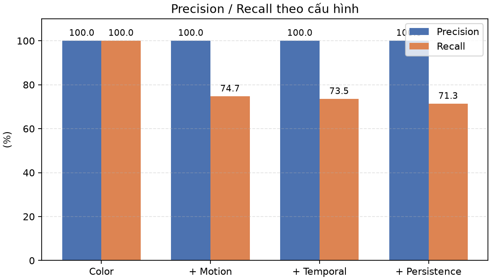

# BÁO CÁO KẾT QUẢ THÀNH VIÊN 4
## Phân tích đặc trưng khói — Lọc phát hiện sai — Đánh giá thực nghiệm (Ablation Study)

> Đề tài: **Phát hiện Lửa & Khói bằng Xử lý ảnh Truyền thống**
>
> Phạm vi báo cáo: kết quả của 4 cấu hình pipeline trên bộ kiểm thử hiện có,
> số liệu lấy trực tiếp từ `outputs/ablation_results.csv` (lần chạy mới nhất).

---

## 1. Cơ sở lý thuyết và cài đặt

### 1.1. Đặc trưng khói (`src/temporal/smoke_temporal.py`)

Với mỗi vùng ứng viên (Region) do tầng màu + chuyển động sinh ra, bốn đặc trưng
được tính trong cửa sổ thời gian:

**a) Độ mờ biên nền — `edge_blur`**

Tính năng lượng biên Sobel của vùng hiện tại và của ảnh nền xám cập nhật trượt:

$$
E_t = \frac{1}{|M|}\sum_{(x,y)\in M}\sqrt{G_x^2(x,y)+G_y^2(x,y)},
\qquad
\text{edge\_blur} = \mathrm{clip}\!\left(\frac{E_t}{E_{bg}+\varepsilon},\,0,\,1.5\right)
$$

Trong đó $M$ là phần lõi mask (erode 11×11 để bỏ viền khói sắc nét). Nền xám được
cập nhật trượt với hệ số `bg_alpha`, nhưng **đóng băng bên trong vùng khói** để
nền không "hấp thụ" chính đối tượng cần đo. Vì khói làm mờ cấu trúc nền, giá trị
`edge_blur < 1` là dấu hiệu của khói; cấu hình dùng thang điểm đảo
`[0.30, 1.00, 0.50]`.

**b) Độ mịn kết cấu — `texture_smoothness`**

Mã LBP 8 láng giềng được tính cho từng pixel trong ROI, sau đó lấy histogram 256 bin:

$$
H = -\sum_{i=1}^{256} p_i \log_2 p_i,
\qquad
\text{texture\_smoothness} = \mathrm{clip}\!\left(1-\frac{H-2.0}{5.5},\,0,\,1\right)
$$

Khói có kết cấu đồng nhất nên entropy thấp, điểm smoothness cao.

**c) Chuyển động hướng lên — `upward_motion`**

Ưu tiên Optical Flow Farnebäck của TV3: tỷ lệ pixel trong ROI có $dy<-0.1$.
Với khói mịn/ít texture, flow gần như bằng 0 nên module tự fallback sang dịch
chuyển trọng tâm giữa hai frame liên tiếp (px/frame).

**d) Tốc độ nở diện tích — `area_growth`**

$$
\text{area\_growth} = \frac{A_t - A_{t-1}}{A_{t-1}+\varepsilon}
$$

Ngoài ra đặc trưng được **làm trơn trượt 5 frame** để giảm nhiễu từng frame.

### 1.2. Đặc trưng hình dạng lửa (`src/temporal/shape_features.py`)

Bổ sung các đặc trưng `scoring.fire` cần:

- `area_variation` = độ lệch chuẩn / trung bình diện tích trên cửa sổ lịch sử.
- `shape_change` = trung bình $1-\mathrm{IoU}(bbox_{t-1}, bbox_t)$.
- `boundary_roughness` = chu vi contour / chu vi bao lồi (lửa có mép gồ ghề).

### 1.3. Hậu xử lý và chấm điểm (`src/filtering/__init__.py`)

- `morphology_clean`: Opening (khử đốm) + Closing (lấp lỗ hổng).
- `extract_candidates`: connected components, lọc `min_area`, `max_area_ratio`,
  `min_aspect`, `max_aspect`, `min_solidity`; xuất thêm `solidity`, `area_ratio`.
- `FeatureScorer`: với mỗi đặc trưng cấu hình `[w, lo, hi]`:

$$
s_i = \mathrm{clip}\!\left(\frac{x_i-lo}{hi-lo},0,1\right),
\qquad
S = \frac{\sum_i w_i s_i}{\sum_i w_i}
$$

  Nếu `hi < lo` thì thang điểm đảo; đặc trưng chưa đủ lịch sử nhận điểm trung tính 0.5.
- `PersistenceVoter`: track phải có `min_hits` lần vượt ngưỡng trong `window`
  frame gần nhất; các frame không vote được ghi 0.

### 1.4. Đánh giá (`src/evaluation/__init__.py`)

Đánh giá cấp frame với TP/FP/TN/FN; IoU tính khi có ground-truth box:

$$
\text{Precision}=\frac{TP}{TP+FP},\quad
\text{Recall}=\frac{TP}{TP+FN},\quad
F_1=\frac{2PR}{P+R}
$$

$$
\text{FPR}=\frac{FP}{FP+TN},\quad
\text{Accuracy}=\frac{TP+TN}{TP+TN+FP+FN},\quad
\text{FPS}=\frac{1}{\overline{t_{frame}}}
$$

---

## 2. Thiết kế thực nghiệm

### 2.1. Dữ liệu kiểm thử

| Nhóm | Số video | Số frame dùng | Ghi chú |
|---|---|---|---|
| Positive (lửa thật) | 6 | 600 | `fire7`, `fire8`, `fire10`, `fire11`, `fire12` (Bilkent) + `pos_wildfire_2012` |
| Negative | 0 | 0 | **Chưa có** video non-fire trong `data/raw` |
| **Tổng** | **6** | **600** | 100 frame đầu mỗi video |

Năm clip `fire7`–`fire12` lấy từ bộ **Bilkent**; clip `pos_wildfire_2012`
(lửa rừng, 292×240, 25 FPS) là video bổ sung ngoài Bilkent. Cả 6 clip đều là
positive và được lấy **100 frame đầu**.

> ⚠️ **Lưu ý quan trọng:** bộ kiểm thử lần này **không có video negative**.
> Vì vậy `TN = FP = 0`, kéo theo:
> - Precision luôn bằng 100% (không có FP),
> - FPR luôn bằng 0% (không có mẫu negative),
> - Accuracy/F1 bị chi phối hoàn toàn bởi Recall.
>
> Các chỉ số Precision, FPR, Accuracy trong mục 3 **không phản ánh khả năng
> chống báo động giả** và không dùng để kết luận tầng lọc nào tốt hơn. Muốn
> đánh giá đầy đủ phải bổ sung video non-fire của Bilkent (`nonfire*.avi`).

### 2.2. Bốn cấu hình bóc tách

| Cấu hình | `use_motion` | `use_temporal` | `use_persistence` | Mục đích |
|---|:---:|:---:|:---:|---|
| 1. Only Color | ✗ | ✗ | ✗ | Baseline màu thuần |
| 2. Color + Motion | ✓ | ✗ | ✗ | Đo tác dụng mask chuyển động |
| 3. + Temporal | ✓ | ✓ | ✗ | Đo tác dụng đặc trưng thời gian/hình dạng |
| 4. Full Pipeline | ✓ | ✓ | ✓ | Đo tác dụng persistence voting |

Tham số: `scoring.fire.threshold = 0.30`, `scoring.smoke.threshold = 0.45`,
`persistence = 8 frame / min_hits 2`, MOG2 + Farnebäck bật.

### 2.3. Cách đo

- Mỗi video được reset detector, chạy 100 frame, đo thời gian `detector.process`.
- Video positive: mọi frame đều kỳ vọng có phát hiện.
- Không có video negative nên TP + FN = 600, FP = TN = 0.
- FPS đo trên CPU, một lần chạy, chưa tính thời gian đọc/ghi video.

---

## 3. Kết quả thực nghiệm

### 3.1. Bảng kết quả (từ `outputs/ablation_results.csv`)

| Cấu hình | TP | FP | TN | FN | Acc (%) | Precision (%) | Recall (%) | F1 (%) | FPR (%) | mIoU (%) | FPS |
|---|---:|---:|---:|---:|---:|---:|---:|---:|---:|---:|---:|
| 1. Only Color | 600 | 0 | 0 | 0 | **100.00** | 100.00 | **100.00** | **100.00** | 0.00 | 0.00 | **52.8** |
| 2. Color + Motion | 448 | 0 | 0 | 152 | 74.67 | 100.00 | 74.67 | 85.50 | 0.00 | 0.00 | 52.4 |
| 3. + Temporal | 441 | 0 | 0 | 159 | 73.50 | 100.00 | 73.50 | 84.73 | 0.00 | 0.00 | 25.2 |
| 4. + Persistence | 428 | 0 | 0 | 172 | 71.33 | 100.00 | 71.33 | 83.27 | 0.00 | 0.00 | 25.4 |

### 3.2. Biểu đồ so sánh




> Biểu đồ Precision và FPR chỉ mang tính minh hoạ vì Precision = 100% và
> FPR = 0% ở mọi cấu hình do không có mẫu negative.

### 3.3. Phân tích từng tầng

**1) Only Color (Baseline).** Trên 600 frame positive, baseline phát hiện đủ
600 frame (Recall 100%), không có FP vì không có negative. F1 = 100% chỉ phản
ánh việc **mọi frame đều là lửa** và màu lửa được bắt rất nhạy — không có nghĩa
pipeline hoàn hảo.

**2) Color + Motion.** Recall giảm mạnh 100% → 74.67% (152 frame bị bỏ sót,
tăng 25.3 điểm phần trăm FN). Nguyên nhân: giao mask màu với MOG2 loại bỏ cả
những vùng lửa ít chuyển động, lửa ở xa, hoặc vùng bị mask chuyển động cắt bớt;
một số đoạn camera rung/zoom làm mask chuyển động không ổn định. Trên bộ dữ
liệu **chỉ có positive**, tầng này không có FP để loại nên chỉ thể hiện mặt
trái (giảm Recall). FPS gần như không đổi (52.8 → 52.4).

**3) Color + Motion + Temporal.** Recall giảm nhẹ 74.67% → 73.50% (thêm 7 FN).
Đặc trưng flicker/LBP/hình dạng cần 8–12 frame lịch sử; các track mới hoặc
track bị đứt do IoU thấp nhận điểm trung tính nên chưa vượt ngưỡng. FPS giảm
mạnh 52.4 → 25.2 do Farnebäck optical flow chạy mỗi frame. Trên dữ liệu có
negative, tầng này sẽ là phần loại FP chính; nhưng bộ hiện tại không đo được.

**4) Full Pipeline (+ Persistence).** Recall còn 71.33% (thêm 13 FN so với
cấu hình 3). Persistence yêu cầu `min_hits = 2` frame vượt ngưỡng trong 8 frame
gần nhất, nên mỗi track bị chặn ít nhất 1 frame đầu; với clip 100 frame và
track ngắn, tổn thất này đáng kể. Precision/FPR không đổi (vẫn 100%/0%) do
không có negative.

**Tổng hợp:** trong điều kiện **positive-only**, cấu hình càng thêm tầng lọc thì
Recall càng giảm, nên F1 giảm dần từ 100% → 83.27%. Đây là kết quả **không đủ
để kết luận** hiệu quả của các tầng lọc phát hiện sai: bản chất các tầng
Motion/Temporal/Persistence là giảm FP, mà FP không tồn tại trong tập test này.

### 3.4. Phân tích lỗi (Failure cases)

1. **Lửa ít chuyển động / ở xa:** mask MOG2 không phủ hoặc phủ không đủ vùng
   lửa → FN tăng mạnh ở cấu hình 2 (152 frame).
2. **Track mới / track đứt:** đặc trưng flicker, LBP, area_variation cần lịch
   sử 8–12 frame; track mới nhận điểm trung tính, dễ trượt ngưỡng.
3. **Persistence warm-up:** mỗi track mất ít nhất `min_hits-1` frame đầu; với
   clip ngắn, đây là nguyên nhân chính làm Recall giảm ở cấu hình 4.
4. **Camera rung/zoom:** mask chuyển động không ổn định, có thể vừa làm mất
   vùng lửa thật vừa tạo vùng nhiễu.
5. **Chưa đo được báo động giả:** không có video negative nên không thể phân
   tích các trường hợp đèn, mặt trời, mây, ô tô trắng.

### 3.5. Hạn chế

- **Không có video negative** → Precision/FPR/Accuracy không có ý nghĩa thống kê;
  không thể chứng minh hiệu quả giảm báo động giả của Motion/Temporal/Persistence.
- Chỉ có 6 video positive, lấy 100 frame đầu mỗi video.
- 1/6 video (`pos_wildfire_2012`) không thuộc Bilkent và có độ phân giải/FPS khác.
- `Mean IoU = 0` vì chưa có annotation bounding box.
- Ngưỡng trong `configs/default.yaml` được tinh chỉnh trên bộ demo trước đó,
  chưa tune lại trên Bilkent.
- FPS đo trên CPU, một lần chạy, phụ thuộc cấu hình máy.

### 3.6. Kết luận

Trên bộ 600 frame positive hiện tại, pipeline phát hiện lửa tốt ở baseline
(Recall 100%) nhưng các tầng Motion → Temporal → Persistence lần lượt làm giảm
Recall xuống 74.67% → 73.50% → 71.33%. Nguyên nhân không phải các tầng này vô
dụng, mà do **tập kiểm thử thiếu hoàn toàn mẫu negative** — trong khi mục tiêu
chính của chúng là loại báo động giả.

Để báo cáo có kết luận ablation đúng nghĩa, cần bổ sung **video non-fire của
Bilkent** (`nonfire*.avi`) vào `data/raw`, chạy lại với cùng giao thức (100 hoặc
300 frame/video). Khi đó mới so sánh được Precision, FPR và F1 giữa 4 cấu hình;
bảng số hiện tại chỉ nên dùng để phân tích Recall trên dữ liệu positive.

---

## 4. Cách tái lập kết quả

```bash
# chạy ablation (100 frame/video như số liệu trong báo cáo)
python -m scripts.run_ablation --max-frames 100

# vẽ lại biểu đồ từ CSV
python -m scripts.plot_ablation

# xem bảng kết quả
python -c "import pandas as pd; print(pd.read_csv('outputs/ablation_results.csv'))"
```

File sinh ra:

- `outputs/ablation_results.csv` — bảng số liệu
- `docs/report/ablation_f1_fpr.png` — biểu đồ F1/FPR
- `docs/report/ablation_precision_recall.png` — biểu đồ Precision/Recall
