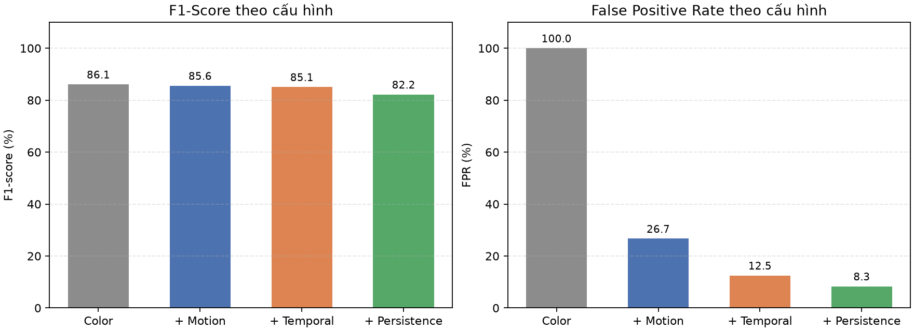

# BÁO CÁO KẾT QUẢ THÀNH VIÊN 4
## Phân tích đặc trưng khói — Lọc phát hiện sai — Đánh giá thực nghiệm (Ablation Study)

> Đề tài: **Phát hiện Lửa & Khói bằng Xử lý ảnh Truyền thống**
>
> Phạm vi báo cáo: kết quả của 4 cấu hình pipeline trên bộ kiểm thử hiện có,
> số liệu lấy trực tiếp từ `outputs/ablation_results.csv`.

---

## 1. Cơ sở lý thuyết và cài đặt

### 1.1. Đặc trưng khói (`src/temporal/smoke_temporal.py`)

Với mỗi vùng ứng viên (Region) do tầng màu + chuyển động sinh ra, bốn đặc trưng
được tính trong cửa sổ thời gian:

**a) Độ mờ biên nền — `edge_blur`**

Tính năng lượng biên Sobel của vùng hiện tại và của ảnh nền xám cập nhật trượt:

$$
E_t = \frac{1}{|M|}\sum_{(x,y)\in M}\sqrt{G_x^2(x,y)+G_y^2(x,y)},
\qquad
\text{edge\_blur} = \mathrm{clip}\!\left(\frac{E_t}{E_{bg}+\varepsilon},\,0,\,1.5\right)
$$

Trong đó $M$ là phần lõi mask (erode 11×11 để bỏ viền khói sắc nét). Nền xám được
cập nhật trượt với hệ số `bg_alpha`, nhưng **đóng băng bên trong vùng khói** để
nền không "hấp thụ" chính đối tượng cần đo. Vì khói làm mờ cấu trúc nền, giá trị
`edge_blur < 1` là dấu hiệu của khói; cấu hình dùng thang điểm đảo
`[0.30, 1.00, 0.50]`.

**b) Độ mịn kết cấu — `texture_smoothness`**

Mã LBP 8 láng giềng được tính cho từng pixel trong ROI, sau đó lấy histogram 256 bin:

$$
H = -\sum_{i=1}^{256} p_i \log_2 p_i,
\qquad
\text{texture\_smoothness} = \mathrm{clip}\!\left(1-\frac{H-2.0}{5.5},\,0,\,1\right)
$$

Khói có kết cấu đồng nhất nên entropy thấp, điểm smoothness cao.

**c) Chuyển động hướng lên — `upward_motion`**

Ưu tiên Optical Flow Farnebäck của TV3: tỷ lệ pixel trong ROI có $dy<-0.1$.
Với khói mịn/ít texture, flow gần như bằng 0 nên module tự fallback sang dịch
chuyển trọng tâm giữa hai frame liên tiếp (px/frame).

**d) Tốc độ nở diện tích — `area_growth`**

$$
\text{area\_growth} = \frac{A_t - A_{t-1}}{A_{t-1}+\varepsilon}
$$

Ngoài ra đặc trưng được **làm trơn trượt 5 frame** để giảm nhiễu từng frame.

### 1.2. Đặc trưng hình dạng lửa (`src/temporal/shape_features.py`)

Bổ sung các đặc trưng `scoring.fire` cần:

- `area_variation` = độ lệch chuẩn / trung bình diện tích trên cửa sổ lịch sử.
- `shape_change` = trung bình $1-\mathrm{IoU}(bbox_{t-1}, bbox_t)$.
- `boundary_roughness` = chu vi contour / chu vi bao lồi (lửa có mép gồ ghề).

### 1.3. Hậu xử lý và chấm điểm (`src/filtering/__init__.py`)

- `morphology_clean`: Opening (khử đốm) + Closing (lấp lỗ hổng).
- `extract_candidates`: connected components, lọc `min_area`, `max_area_ratio`,
  `min_aspect`, `max_aspect`, `min_solidity`; xuất thêm `solidity`, `area_ratio`.
- `FeatureScorer`: với mỗi đặc trưng cấu hình `[w, lo, hi]`:

$$
s_i = \mathrm{clip}\!\left(\frac{x_i-lo}{hi-lo},0,1\right),
\qquad
S = \frac{\sum_i w_i s_i}{\sum_i w_i}
$$

  Nếu `hi < lo` thì thang điểm đảo; đặc trưng chưa đủ lịch sử nhận điểm trung tính 0.5.
- `PersistenceVoter`: track phải có `min_hits` lần vượt ngưỡng trong `window`
  frame gần nhất; các frame không vote được ghi 0.

### 1.4. Đánh giá (`src/evaluation/__init__.py`)

Đánh giá cấp frame với TP/FP/TN/FN; IoU tính khi có ground-truth box:

$$
\text{Precision}=\frac{TP}{TP+FP},\quad
\text{Recall}=\frac{TP}{TP+FN},\quad
F_1=\frac{2PR}{P+R}
$$

$$
\text{FPR}=\frac{FP}{FP+TN},\quad
\text{Accuracy}=\frac{TP+TN}{TP+TN+FP+FN},\quad
\text{FPS}=\frac{1}{\overline{t_{frame}}}
$$

---

## 2. Thiết kế thực nghiệm

### 2.1. Dữ liệu kiểm thử hiện có

| Nhóm | Số video | Số frame dùng | Ghi chú |
|---|---|---|---|
| Positive (lửa/khói thật) | 5 | 300 | `fire7`, `fire8`, `fire10`, `fire11`, `fire12` |
| Positive (demo tổng hợp) | 2 | 120 | `pos_fire`, `pos_smoke` |
| Negative (demo tổng hợp) | 2 | 120 | `neg_traffic`, `neg_sunset` |
| **Tổng** | **9** | **540** | 420 frame positive, 120 frame negative |

Quy ước: lấy **60 frame đầu** mỗi video (từ CSV: `TP+FN = 420`, `FP+TN = 120`).
Video cháy rừng dài `3_2012-07-17_15-30-45.avi` chưa được đưa vào vì tên không
khớp quy ước `pos/fire/smoke`. Bộ negative hiện chỉ gồm video demo nên FPR chỉ
mang tính minh hoạ xu hướng.

Tiền xử lý chung: resize giữ tỉ lệ về rộng 640 px, Gaussian blur 5×5, chuyển HSV/YCbCr.

### 2.2. Bốn cấu hình bóc tách

| Cấu hình | `use_motion` | `use_temporal` | `use_persistence` | Mục đích |
|---|:---:|:---:|:---:|---|
| 1. Only Color | ✗ | ✗ | ✗ | Baseline màu thuần |
| 2. Color + Motion | ✓ | ✗ | ✗ | Đo tác dụng mask chuyển động |
| 3. + Temporal | ✓ | ✓ | ✗ | Đo tác dụng đặc trưng thời gian/hình dạng |
| 4. Full Pipeline | ✓ | ✓ | ✓ | Đo tác dụng persistence voting |

Tham số liên quan: `scoring.fire.threshold = 0.30`, `scoring.smoke.threshold = 0.45`,
`persistence = 8 frame / min_hits 2`, MOG2 + Farnebäck bật.

### 2.3. Cách đo

- Mỗi video được reset detector, chạy 60 frame, đo thời gian `detector.process`.
- Video positive: mọi frame đều kỳ vọng có phát hiện; video negative: không có.
- Chỉ số tổng hợp trên toàn bộ 540 frame cho từng cấu hình.

---

## 3. Kết quả thực nghiệm

### 3.1. Bảng kết quả (từ `outputs/ablation_results.csv`)

| Cấu hình | TP | FP | TN | FN | Acc (%) | Precision (%) | Recall (%) | F1 (%) | FPR (%) | mIoU (%) | FPS |
|---|---:|---:|---:|---:|---:|---:|---:|---:|---:|---:|---:|
| 1. Only Color | 408 | 120 | 0 | 12 | 75.56 | 77.27 | **97.14** | **86.08** | 100.00 | 0.00 | **34.3** |
| 2. Color + Motion | 338 | 32 | 88 | 82 | 78.89 | 91.35 | 80.48 | 85.57 | 26.67 | 0.00 | 32.6 |
| 3. + Temporal | 322 | 15 | 105 | 98 | **79.07** | 95.55 | 76.67 | 85.07 | 12.50 | 0.00 | 18.6 |
| 4. + Persistence | 300 | **10** | **110** | 120 | 75.93 | **96.77** | 71.43 | 82.19 | **8.33** | 0.00 | 18.3 |

### 3.2. Biểu đồ so sánh




### 3.3. Phân tích từng tầng

**1) Only Color (Baseline).** Recall 97.14% (chỉ 12/420 frame bỏ sót) nhưng FPR
100%: cả 120 frame negative đều bị báo cháy. Nguyên nhân: mask màu không phân biệt
được đèn vàng/đỏ, ô tô trắng, mảng mây xám và hoàng hôn với lửa/khói.

**2) Color + Motion.** Giao mask màu với MOG2 loại phần lớn nguồn sáng tĩnh:
FP giảm 120 → 32, FPR 100% → 26.67%, Precision tăng 77.27% → 91.35%. Đổi lại,
Recall giảm còn 80.48% vì một số vùng lửa/khói bị mask chuyển động cắt bớt hoặc
bị hấp thụ vào nền.

**3) Color + Motion + Temporal.** Đặc trưng FFT/lửa, Sobel–LBP/khói và hình dạng
loại thêm 17 FP (32 → 15), FPR còn 12.50%, Precision đạt 95.55%. Recall giảm
80.48% → 76.67% do các track mới chưa đủ 8–12 frame lịch sử để tính flicker/LBP
và do ngưỡng chấm điểm khá chặt. FPS giảm mạnh 32.6 → 18.6 do Farnebäck optical
flow chạy mỗi frame.

**4) Full Pipeline (+ Persistence).** Voting 8 frame/min_hits 2 loại thêm 5 FP
(15 → 10), FPR thấp nhất 8.33%, Precision cao nhất 96.77%. Tuy nhiên cơ chế
"khởi động" của persistence làm mất thêm 22 TP (FN 98 → 120), Recall còn 71.43%.
Với clip chỉ 60 frame, vài frame đầu mỗi track bị chặn là tổn thất đáng kể; trên
video dài hơn, chi phí này gần như không đáng kể.

**Tổng hợp:** trong bộ kiểm thử nhỏ này, F1 cao nhất ở cấu hình 2 (85.57%),
Precision/FPR tốt nhất ở cấu hình 4 (96.77% / 8.33%), Recall tốt nhất ở baseline
(97.14%). Kết quả thể hiện đúng trade-off Precision–Recall của từng tầng lọc;
không có cấu hình nào trội toàn diện do dữ liệu ít và clip ngắn.

### 3.4. Phân tích lỗi (Failure cases)

1. **Khói loãng / ban đêm:** `edge_blur ≈ 1` và entropy LBP cao → điểm khói thấp,
   dễ bỏ sót (đóng góp vào FN tăng ở cấu hình 3–4).
2. **Lửa nhỏ / bị che khuất:** đặc trưng flicker cần 8–12 frame lịch sử; track mới
   hoặc track bị đứt do IoU thấp nhận điểm trung tính nên chưa vượt ngưỡng.
3. **Nhiễu chuyển động toàn khung (rung camera, zoom):** mask MOG2 phủ gần hết
   frame, mask màu không còn được lọc theo chuyển động cục bộ.
4. **Vật thể trắng/xám chuyển động (ô tô, mây):** có thể lọt qua màu + chuyển động;
   tầng temporal loại được phần lớn nhưng vẫn còn 10 FP ở cấu hình 4.
5. **Persistence warm-up:** mỗi track bị chặn `min_hits-1` frame đầu; với clip
   60 frame, đây là nguyên nhân chính khiến Recall cấu hình 4 giảm.

### 3.5. Hạn chế

- Bộ negative chỉ có 2 video demo → FPR chưa đại diện cho dữ liệu thực tế.
- 4/9 video là dữ liệu tổng hợp; chỉ số chưa phản ánh hoàn toàn khói/lửa thật.
- Chỉ dùng 60 frame đầu mỗi video.
- `Mean IoU = 0` vì chưa có annotation bounding box.
- Ngưỡng trong `configs/default.yaml` được tinh chỉnh trên bộ demo hiện tại.
- FPS đo trên CPU, một lần chạy, phụ thuộc cấu hình máy.

### 3.6. Kết luận

Trên bộ kiểm thử hiện có, pipeline chứng minh được vai trò từng tầng: mask chuyển
động giảm mạnh báo động giả, đặc trưng thời gian tăng Precision và giảm FPR,
persistence đạt Precision/FPR tốt nhất. Để số liệu đủ mạnh cho báo cáo cuối kỳ
cần bổ sung video negative thật, đưa video cháy rừng dài vào (đổi tên theo quy ước),
tăng số frame đánh giá và bổ sung annotation box nếu muốn báo cáo mIoU.

---

## 4. Cách tái lập kết quả

```bash
# 1) chạy ablation (60 frame/video như số liệu trong báo cáo)
python -m scripts.run_ablation --max-frames 60

# 2) vẽ lại biểu đồ từ CSV
python -m scripts.plot_ablation

# 3) xem bảng kết quả
python -c "import pandas as pd; print(pd.read_csv('outputs/ablation_results.csv'))"
```

File sinh ra:

- `outputs/ablation_results.csv` — bảng số liệu
- `docs/report/ablation_f1_fpr.png` — biểu đồ F1/FPR
- `docs/report/ablation_precision_recall.png` — biểu đồ Precision/Recall
