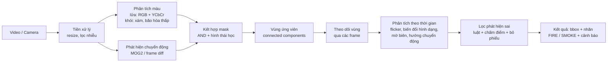
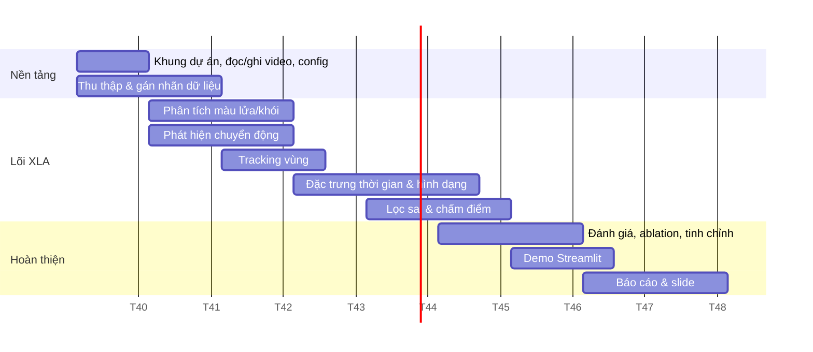

# Kế hoạch triển khai: Phát hiện khói / lửa từ video

> [!IMPORTANT]
> **Nguyên tắc chính:** Phần lõi dùng **xử lý ảnh truyền thống** (không học sâu) để thể hiện rõ năng lực XLA. Kiến trúc được thiết kế dạng **module + interface** để sau này cắm thêm mô hình học sâu mà không phải viết lại.

---

## 1. Tổng quan pipeline



**Ý tưởng cốt lõi:** mỗi tầng loại bớt vùng sai – *màu* loại vật không giống lửa/khói, *chuyển động* loại vật tĩnh (tường đỏ, mây tĩnh), *đặc trưng thời gian* loại vật chuyển động cứng (đèn xe, áo đỏ), *bộ lọc cuối* loại nhiễu ngắn hạn.

---

## 2. Danh sách công nghệ và vai trò

### 2.1. Công nghệ chính

| Công nghệ | Vai trò trong dự án | Lý do chọn |
|---|---|---|
| **Python 3.10+** | Ngôn ngữ chính | Hệ sinh thái XLA/ML mạnh, dễ mở rộng sang học sâu |
| **OpenCV (`opencv-python`)** | Đọc/ghi video, chuyển không gian màu, MOG2/KNN, morphology, contour, optical flow, vẽ kết quả | Thư viện XLA chuẩn, tối ưu C++, đủ mọi thuật toán cần |
| **NumPy** | Phép toán ma trận trên ảnh, vector hóa luật màu, buffer theo thời gian | Nhanh, là nền của OpenCV |
| **SciPy** | FFT/phân tích tần số cho flicker, lọc tín hiệu 1D theo thời gian | Hỗ trợ xử lý tín hiệu |
| **PyWavelets** | Biến đổi wavelet: phát hiện flicker (tần số cao theo thời gian) và mờ biên của khói (năng lượng wavelet không gian giảm) | Kỹ thuật kinh điển (Töreyin et al.), "ăn điểm" về XLA |
| **scikit-image** | Đặc trưng hình dạng (`regionprops`), texture (LBP, GLCM) cho khói | Bổ sung các đặc trưng OpenCV không có sẵn |
| **PyYAML** | File cấu hình ngưỡng/tham số | Tinh chỉnh không cần sửa code, dễ ablation |
| **Matplotlib** | Vẽ biểu đồ histogram màu, tín hiệu flicker, đường cong PR | Minh họa cho báo cáo |
| **pandas** | Tổng hợp kết quả đánh giá, bảng so sánh | Dễ xuất bảng cho báo cáo |
| **Streamlit** (hoặc PyQt5) | Giao diện demo: upload video, xem từng mask trung gian, chỉnh ngưỡng bằng slider | Demo trực quan, thầy cô dễ đánh giá |
| **pytest** | Unit test cho từng module | Đảm bảo chất lượng khi 4 người cùng code |
| **Git + GitHub** | Quản lý mã nguồn, chia nhánh theo module | Làm việc nhóm |

### 2.2. Dữ liệu

| Bộ dữ liệu | Nội dung | Dùng cho |
|---|---|---|
| **Bilkent VisiFire** | Video lửa, khói, video gây nhiễu | Đánh giá chính |
| **MIVIA Fire / Smoke** | 31 video lửa + 149 video khói, có video "khó" (đèn đỏ, mây) | Đánh giá false positive |
| **FIRESENSE** | Video lửa/khói ngoài trời + negative | Đánh giá bổ sung |
| **D-Fire** (ảnh, có bbox YOLO) | ~21.000 ảnh | Giai đoạn mở rộng học sâu |
| Video tự quay | Nến, bật lửa, khói hương, áo đỏ, đèn xe | Test case "đánh lừa" hệ thống |

---

## 3. Thuật toán chi tiết từng module

### 3.1. Tiền xử lý
- Resize về kích thước cố định (vd. 640×360) → ổn định ngưỡng diện tích, tăng FPS.
- Gaussian blur 5×5 để giảm nhiễu cảm biến.
- Chuyển đổi không gian màu: **RGB, HSV, YCbCr**.

### 3.2. Phân tích màu

**Lửa – luật RGB (Chen et al., 2004):**
- `R > R_T` (≈ 115–135), `R ≥ G > B`
- `S ≥ (255 − R) · S_T / R_T` (bão hòa phụ thuộc độ sáng)

**Lửa – luật YCbCr (Çelik & Demirel, 2009):**
- `Y > Cb`, `Cr > Cb`
- `Y > Y_mean`, `Cb < Cb_mean`, `Cr > Cr_mean`
- `|Cb − Cr| ≥ τ` (≈ 40)

→ Kết hợp hai luật (AND hoặc bỏ phiếu) để giảm sai.

**Khói:**
- Gần xám: `max(|R−G|, |G−B|, |R−B|) < α` (≈ 15–20)
- Bão hòa thấp trong HSV: `S < S_smoke`
- Độ sáng trung bình: `L1 ≤ I ≤ L2` (khói xám nhạt / xám đậm)

> [!TIP]
> Thể hiện năng lực XLA: vẽ **histogram 2D (Cb–Cr, H–S)** của pixel lửa/khói thật từ ground truth để *biện minh* cho ngưỡng thay vì chọn ngưỡng cảm tính.

### 3.3. Phát hiện chuyển động
- **Background subtraction MOG2/KNN** (`cv2.createBackgroundSubtractorMOG2`) – chính.
- **Frame differencing 3 frame** – nhẹ, dùng so sánh.
- **Optical flow Farnebäck** trên vùng ứng viên → hướng chuyển động (khói thường đi **lên**, lan tỏa).
- Mask chuyển động ∩ mask màu → mask ứng viên.

### 3.4. Phân tích biến đổi theo thời gian (phần "khó", trọng tâm điểm)

Mỗi vùng ứng viên được **theo dõi** (ghép theo IoU/khoảng cách tâm) và giữ **buffer N frame** (≈ 15–30 frame).

| Đặc trưng | Cách tính | Lửa | Khói |
|---|---|---|---|
| **Flicker** | Đếm số lần pixel đổi trạng thái lửa/không-lửa, hoặc năng lượng wavelet/FFT tần số cao (~10 Hz) của chuỗi cường độ | Cao | Thấp–TB |
| **Biến thiên diện tích** | `std(area) / mean(area)` qua N frame | Dao động mạnh | Tăng dần |
| **Độ bất thường biên** | Circularity `4πA/P²`, tỉ lệ convex hull (solidity) | Thấp, biên răng cưa | Biên mờ |
| **Biến thiên hình dạng** | Thay đổi Hu moments / IoU giữa các frame liên tiếp | Lớn | Vừa |
| **Dịch chuyển tâm** | Quỹ đạo tâm vùng | Dao động tại chỗ | Đi lên |
| **Mờ biên (khói)** | Năng lượng tần số cao (wavelet / variance Laplacian) vùng hiện tại so với nền | – | Giảm (khói bán trong suốt) |
| **Texture (khói)** | LBP histogram / GLCM | – | Mịn, đồng nhất |

### 3.5. Lọc phát hiện sai
1. **Hình thái học:** opening (khử điểm lẻ) + closing (lấp lỗ).
2. **Ngưỡng diện tích:** loại vùng quá nhỏ / quá lớn.
3. **Ràng buộc hình học:** tỉ lệ khung, solidity.
4. **Tính bền vững theo thời gian:** vùng phải tồn tại ≥ K trong N frame (sliding-window voting).
5. **Chấm điểm tổng hợp:** `score = Σ wᵢ · fᵢ` (màu, flicker, biến thiên hình dạng, hướng chuyển động…) → vượt ngưỡng mới báo.
6. **Danh sách loại trừ cụ thể:**
   - Vật đỏ tĩnh → loại bởi chuyển động.
   - Áo đỏ/xe đỏ di chuyển → hình dạng cứng, flicker thấp.
   - Đèn xe/đèn nhấp nháy → nhấp nháy đều (tần số đơn), hình dạng ổn định.
   - Mây/sương → không có chuyển động cục bộ, không lan tỏa từ một nguồn.

---

## 4. Cấu trúc dự án đề xuất

```text
fire_smoke_detection/
├── README.md
├── requirements.txt
├── configs/
│   └── default.yaml            # Toàn bộ ngưỡng, tham số
├── data/
│   ├── raw/                    # Video gốc (không commit)
│   ├── annotations/            # Ground truth (bbox / nhãn frame)
│   └── samples/                # Video ngắn để demo/test
├── src/
│   ├── __init__.py
│   ├── io/
│   │   ├── video_reader.py     # Đọc video/camera, generator frame
│   │   └── video_writer.py     # Ghi video kết quả
│   ├── preprocessing/
│   │   └── preprocess.py       # Resize, blur, chuyển không gian màu
│   ├── color/
│   │   ├── fire_color.py       # Luật RGB, YCbCr
│   │   └── smoke_color.py      # Luật xám, HSV
│   ├── motion/
│   │   ├── background.py       # MOG2, KNN, frame diff
│   │   └── optical_flow.py     # Farnebäck, hướng chuyển động
│   ├── tracking/
│   │   └── region_tracker.py   # Ghép vùng qua frame, quản lý buffer
│   ├── temporal/
│   │   ├── flicker.py          # Flicker (đếm / wavelet / FFT)
│   │   ├── shape_features.py   # Diện tích, circularity, Hu moments
│   │   └── smoke_features.py   # Mờ biên, texture LBP
│   ├── filtering/
│   │   ├── morphology.py
│   │   ├── rules.py            # Luật hình học, persistence
│   │   └── scoring.py          # Chấm điểm, quyết định
│   ├── detectors/
│   │   ├── base.py             # Interface BaseDetector  ← điểm mở rộng DL
│   │   ├── classical.py        # Pipeline xử lý ảnh truyền thống
│   │   └── deep.py             # (Sau này) YOLO / CNN
│   ├── evaluation/
│   │   ├── metrics.py          # Precision, Recall, F1, FAR, độ trễ
│   │   └── evaluate.py         # Chạy trên bộ dữ liệu, xuất bảng
│   └── visualization/
│       └── draw.py             # Vẽ bbox, ghép lưới mask trung gian
├── app/
│   └── streamlit_app.py        # Demo giao diện
├── scripts/
│   ├── run_video.py            # CLI: python scripts/run_video.py --input x.mp4
│   ├── run_ablation.py         # Bật/tắt từng module, so sánh
│   └── analyze_color.py        # Vẽ histogram màu từ ground truth
├── notebooks/                  # Thử nghiệm, minh họa cho báo cáo
├── tests/                      # pytest cho từng module
└── docs/
    └── report/                 # Báo cáo, hình ảnh
```

**Interface mở rộng (điểm mấu chốt cho học sâu):**

```python
# src/detectors/base.py
from abc import ABC, abstractmethod
from dataclasses import dataclass
import numpy as np

@dataclass
class Detection:
    bbox: tuple[int, int, int, int]   # x, y, w, h
    label: str                        # "fire" | "smoke"
    score: float

class BaseDetector(ABC):
    @abstractmethod
    def process(self, frame: np.ndarray) -> list[Detection]:
        """Nhận 1 frame BGR, trả về danh sách phát hiện."""
```

`ClassicalDetector` và sau này `YoloDetector` / `HybridDetector` đều cài đặt interface này → app, evaluation, CLI dùng chung.

---

## 5. Luồng triển khai (10 tuần)



| Giai đoạn | Tuần | Đầu ra (milestone) |
|---|---|---|
| **0. Khởi động** | 1 | Repo, cấu trúc, `run_video.py` đọc–hiển thị–ghi video; config YAML |
| **1. Dữ liệu** | 1–2 | ≥ 20 video lửa, ≥ 20 khói, ≥ 15 video nhiễu; ground truth mức frame |
| **2. MVP** | 2–3 | Màu + chuyển động + morphology → vẽ bbox. **Chạy được end-to-end** |
| **3. Tracking** | 3–4 | Mỗi vùng có ID và buffer lịch sử |
| **4. Đặc trưng thời gian** | 4–6 | Flicker, biến thiên hình dạng, mờ biên, hướng chuyển động |
| **5. Lọc sai** | 5–6 | Persistence + scoring; giảm rõ false positive |
| **6. Đánh giá** | 6–8 | Bảng ablation, tinh chỉnh ngưỡng, đo FPS |
| **7. Demo + báo cáo** | 7–10 | App Streamlit hiển thị mask trung gian; báo cáo, slide |

> [!TIP]
> Làm **MVP end-to-end sớm (tuần 3)** rồi cải tiến dần từng module. Tránh việc mỗi người làm riêng đến cuối mới ghép.

---

## 6. Phân công cho 4 thành viên

| Thành viên | Vai trò | Module phụ trách | Việc phụ |
|---|---|---|---|
| **TV1** – Trưởng nhóm / Tích hợp | Kiến trúc, tích hợp | `io`, `preprocessing`, `detectors/classical.py`, config | Review code, quản lý Git, ghép pipeline |
| **TV2** – Màu sắc & Dữ liệu | Phân tích màu | `color/*`, `scripts/analyze_color.py` | Thu thập, gán nhãn dữ liệu; histogram màu |
| **TV3** – Chuyển động & Thời gian | Motion + đặc trưng động | `motion/*`, `tracking/*`, `temporal/flicker.py` | Optical flow, wavelet flicker |
| **TV4** – Hình dạng, Lọc sai & Đánh giá | Lọc FP, đo lường | `temporal/shape_features.py`, `smoke_features.py`, `filtering/*`, `evaluation/*` | Ablation, Streamlit demo |

**Ước lượng khối lượng (giờ công):**

| Hạng mục | Giờ ước tính | Người chính |
|---|---|---|
| Khung dự án, I/O, config, tích hợp | 25 | TV1 |
| Thu thập + gán nhãn dữ liệu | 30 | TV2 (+ cả nhóm) |
| Phân tích màu lửa + khói, biện minh ngưỡng | 30 | TV2 |
| Phát hiện chuyển động + optical flow | 25 | TV3 |
| Tracking vùng | 20 | TV3 |
| Flicker (đếm + wavelet/FFT) | 20 | TV3 |
| Đặc trưng hình dạng + khói (mờ biên, LBP) | 30 | TV4 |
| Lọc sai, scoring, persistence | 25 | TV4 |
| Đánh giá, ablation, tinh chỉnh | 30 | TV4 + TV1 |
| Demo Streamlit | 20 | TV1 |
| Unit test | 15 | Cả nhóm |
| Báo cáo + slide | 40 | Cả nhóm |
| **Tổng** | **≈ 310 giờ** | **≈ 75–80 giờ/người, ~8 giờ/tuần × 10 tuần** |

---

## 7. Đánh giá (phần quan trọng để chứng minh chất lượng)

- **Chỉ số mức frame:** Precision, Recall, F1.
- **Chỉ số mức sự kiện:** tỉ lệ video phát hiện đúng, **False Alarm Rate** trên video nhiễu, **độ trễ phát hiện** (số giây từ khi lửa xuất hiện đến khi báo).
- **Hiệu năng:** FPS trên CPU.
- **Ablation study** (rất nên có):

| Cấu hình | Precision | Recall | F1 | FAR |
|---|---|---|---|---|
| Chỉ màu | | | | |
| Màu + chuyển động | | | | |
| + Morphology & lọc hình học | | | | |
| + Đặc trưng thời gian | | | | |
| + Persistence & scoring (đầy đủ) | | | | |

→ Chứng minh **mỗi kỹ thuật đều đóng góp** vào kết quả – đây là cách thể hiện năng lực XLA thuyết phục nhất.

---

## 8. Đề xuất mở rộng hướng học sâu

Xếp theo mức độ tăng dần, tận dụng tối đa phần đã làm:

| Bước | Hướng | Mô tả | Tận dụng phần cũ |
|---|---|---|---|
| **1** | **ML cổ điển trên đặc trưng thủ công** | Thay luật chấm điểm bằng SVM / Random Forest học từ vector đặc trưng (màu, flicker, hình dạng) | Toàn bộ đặc trưng – cầu nối tự nhiên |
| **2** | **Hybrid: XLA đề xuất + CNN xác minh** ⭐ | Pipeline XLA sinh vùng ứng viên → crop → CNN nhẹ (MobileNetV3, EfficientNet-B0) phân loại fire/smoke/none | Giữ nguyên pipeline, chỉ thay bước lọc cuối. Nhanh hơn chạy CNN toàn ảnh |
| **3** | **Object detection end-to-end** | YOLOv8 / YOLO11 huấn luyện trên D-Fire; so sánh với pipeline XLA | Dùng chung `BaseDetector`, `evaluation` |
| **4** | **Mô hình thời gian** | CNN + LSTM/GRU, 3D-CNN (C3D, X3D), hoặc Video Transformer trên chuỗi crop vùng ứng viên | Tracking cung cấp chuỗi crop sẵn |
| **5** | **Two-stream** | Nhánh RGB + nhánh optical flow | Optical flow đã có |
| **6** | **Phân đoạn ngữ nghĩa** | U-Net / DeepLabV3+ cho mask lửa/khói mức pixel | Mask XLA dùng làm nhãn yếu (weak label) |
| **7** | **Triển khai thực tế** | Xuất ONNX / TensorRT, chạy trên Jetson Nano / Raspberry Pi, đa camera, gửi cảnh báo (Telegram) | Kiến trúc module |

> [!NOTE]
> Hướng **(2) Hybrid** là đề xuất tốt nhất cho giai đoạn tiếp theo: vừa giữ được giá trị phần XLA, vừa giảm mạnh false positive, vừa có câu chuyện rõ ràng cho báo cáo ("XLA truyền thống làm bộ lọc nhanh, học sâu làm bộ xác minh chính xác").

---

## 9. Tài liệu tham khảo chính
1. T.-H. Chen et al., *An early fire-detection method based on image processing*, ICIP 2004.
2. T. Çelik, H. Demirel, *Fire detection in video sequences using a generic color model*, Fire Safety Journal, 2009.
3. B. U. Töreyin et al., *Computer vision based method for real-time fire and flame detection*, Pattern Recognition Letters, 2006.
4. B. U. Töreyin et al., *Wavelet based real-time smoke detection in video*, EUSIPCO 2005.
5. P. Foggia et al., *Real-time fire detection for video surveillance applications using a combination of experts based on color, shape and motion*, IEEE TCSVT, 2015 (MIVIA dataset).
6. Z. Zivkovic, *Improved adaptive Gaussian mixture model for background subtraction*, ICPR 2004 (MOG2).
